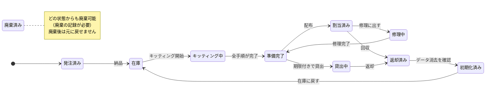
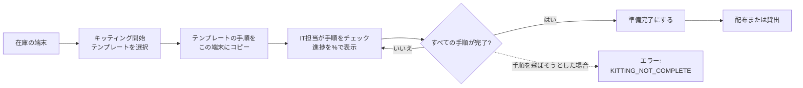
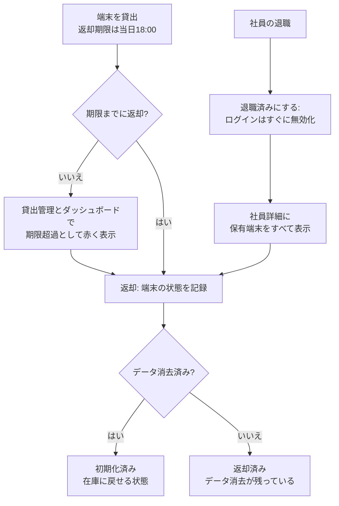
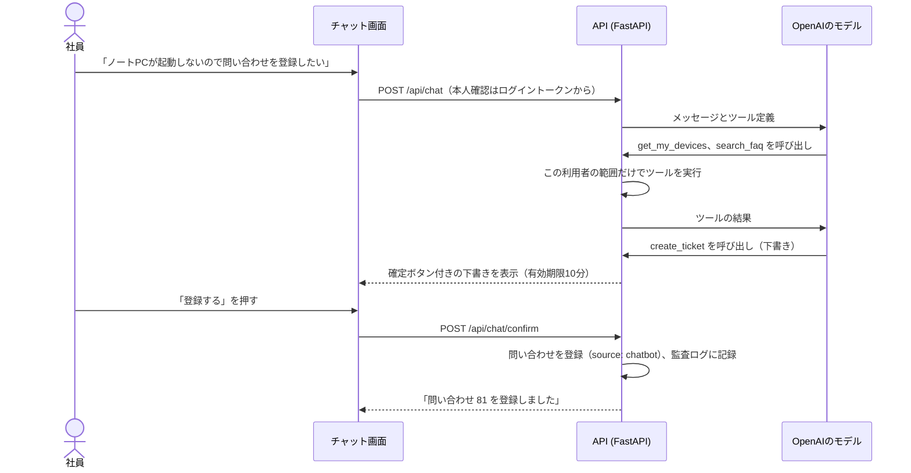
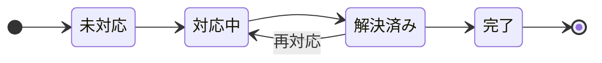
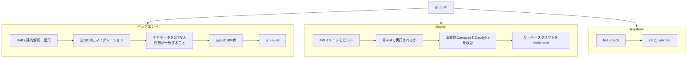
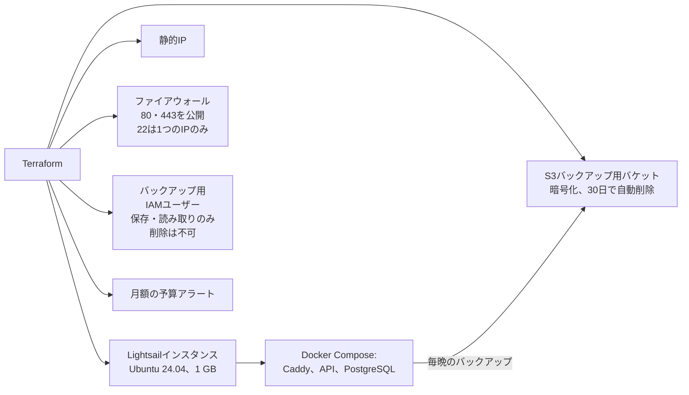

# 日英対応 IT資産・デバイス管理システム

**Bilingual ITSM Device Management System**

会社のPC・スマートフォン・タブレットを、購入からキッティング、配布、貸出、返却、データ消去、廃棄まで
一元管理する日英対応のWebシステムです。端末に関わるヘルプデスク業務（問い合わせ、FAQ、問い合わせを
登録できるチャットボット）もあわせて扱います。

[](https://github.com/amishanita/bilingual-itsm-device-management-system/actions/workflows/ci.yml)


[English README](README.md)


| 684 | 49 | 13 | 12 | 476 | 2 |
| :---: | :---: | :---: | :---: | :---: | :---: |
| 自動テスト | APIエンドポイント | テーブル | 画面 | 翻訳済みの表示文言 | 対応言語 |

## 目次

1. [開発の背景](#開発の背景)
2. [このプロジェクトで示せるスキル](#このプロジェクトで示せるスキル)
3. [画面ごとの機能](#画面ごとの機能)
4. [業務の流れ](#業務の流れ)
5. [ロールと権限](#ロールと権限)
6. [画面](#画面)
7. [システム構成とデータモデル](#システム構成とデータモデル)
8. [API一覧](#api一覧)
9. [品質とテスト](#品質とテスト)
10. [セキュリティ](#セキュリティ)
11. [ローカルでの起動](#ローカルでの起動)
12. [設定項目](#設定項目)
13. [デモデータ](#デモデータ)
14. [AWSへのデプロイ](#awsへのデプロイ)
15. [フォルダ構成](#フォルダ構成)
16. [運用ドキュメント](#運用ドキュメント)
17. [対象範囲と制約](#対象範囲と制約)
18. [今後の改善予定](#今後の改善予定)

## 開発の背景

私は日本でITヘルプデスクとして働いています。業務の多くは、Windows AutopilotとIntuneを使った
PC・スマートフォンのキッティング、資産台帳の更新、予備端末の貸出と返却期限を過ぎた端末の回収、
そして何度も寄せられる同じ質問への対応です。実際には、これらの情報がExcel、MDMの管理画面、
問い合わせツール、担当者の記憶に分散し、少しずつずれていきます。

このシステムは、端末まわりの業務を1か所にまとめ、普段手作業で守っている手順をシステム側で
担保するために作りました。キッティングごとのチェックリスト、データ消去を飛ばせないライフサイクル、
退職者が保有している端末をすべて一覧できる退職処理、そして「誰がいつ何を変更したか」の記録が中心です。

**デモ：** 現在は未公開です。Terraformのコードと構築手順書は準備済みで、サーバーを公開して動作を
確認した後にここへURLを記載します。

## このプロジェクトで示せるスキル

| 分野 | 取り組んだこと | 確認できる場所 |
| --- | --- | --- |
| **ITヘルプデスク** | ステータス・優先度・担当者・コメントを管理する問い合わせ対応フロー。実際のヘルプデスクでよくある質問をもとにした日英20件のFAQ。FAQを検索し、利用者の確認後に問い合わせを登録するチャットボット。 | [問い合わせ](docs/screenshots/09-ticket.png)、[FAQ](docs/screenshots/10-faq.png)、`backend/app/services/chatbot.py` |
| **IT資産管理** | ルールで制御された端末ライフサイクル、端末種別ごとのキッティングチェックリスト（Autopilot / Intune、iPhone、Android、共用端末の再キッティング）、返却期限付きの貸出、退職時の端末回収、保証終了の通知、CSVでの取り込み・出力、すべての変更履歴。 | [端末詳細](docs/screenshots/04-device-kitting.png)、[貸出管理](docs/screenshots/06-loans.png)、[退職処理](docs/screenshots/07-employee-leaver.png) |
| **社内SE・開発** | FastAPIとサービス層によるREST API、PostgreSQLとAlembicによるマイグレーション、ロールに応じたアクセス制御とSQLでの参照範囲の制御、フレームワークを使わない日英切り替え対応のフロントエンド。 | `backend/app/`、`frontend/` |
| **インフラ** | 開発・本番のDocker Compose、CaddyによるHTTPSの自動化、TerraformによるAWS構築（Lightsail、S3、IAM、予算アラート）、毎晩の暗号化バックアップと毎週のリストア確認。 | `docker-compose.prod.yml`、`infra/terraform/`、`scripts/` |
| **セキュリティ** | bcrypt、有効期限の短いJWT、回数制限、厳格なContent Security Policy、最小権限のIAM、秘密情報をGitとTerraformのstateに残さない設計。 | [セキュリティ](#セキュリティ) |
| **品質保証・運用** | 684件の自動テスト、ロール別の権限確認を含むPostmanコレクション、全画面のブラウザ確認、push時のCI、日本語の構築・運用・障害対応手順書。 | [品質とテスト](#品質とテスト)、[docs/](docs/) |

## 画面ごとの機能

| 画面 | 主な利用者 | 内容 |
| --- | --- | --- |
| **サインイン** | 全員 | メールアドレスとパスワード、パスワードの表示切り替え、Caps Lockの警告、言語切り替え。 |
| **ダッシュボード** | マネージャー以上 | 稼働中の端末、キッティング中、返却期限超過の貸出、非準拠の端末、未解決の問い合わせの件数。種別ごとの端末数とカテゴリ別の未解決問い合わせのグラフ。60日以内に保証が終了する端末。 |
| **端末一覧** | 全員（一般社員は自分の端末のみ） | 種別・ステータス・OS・コンプライアンス・貸出期限での絞り込み、資産番号・シリアル番号・IMEI・電話番号・社員名での検索、端末の登録。 |
| **端末詳細** | 全員（参照範囲内） | 全項目と技術情報、次に実行できるステータス変更だけのボタン、進捗バー付きのキッティングチェックリスト、貸出履歴、関連する問い合わせ、変更履歴。 |
| **キッティング** | IT担当 | キッティング中の端末を担当者別・進捗率付きで表示。 |
| **貸出管理** | IT担当、マネージャー | 貸出中・期限超過・返却済み・すべての切り替え、期限超過は赤で表示、返却期限付きの貸出フォーム、状態とデータ消去を記録する返却フォーム。 |
| **社員一覧** | IT担当、マネージャー | 一覧と検索、社員の登録。 |
| **社員詳細** | IT担当、マネージャー | 社員情報と編集、退職済みにする操作、保有している全端末とそれぞれの返却手段、その社員の問い合わせ。 |
| **問い合わせ一覧** | 全員（参照範囲内） | ステータス・優先度・カテゴリでの絞り込み、検索、問い合わせの登録。 |
| **問い合わせ詳細** | 全員（参照範囲内） | ステータス、優先度、担当者、コメント、関連端末。 |
| **FAQ** | 全員 | 利用者の言語でカテゴリ別に表示し、検索も可能。IT担当は日英を並べて編集。 |
| **ユーザー管理** | システム管理者 | ログインの作成、ロール変更、有効・無効、社員との紐付け、パスワードの再設定。 |
| **チャット画面** | 全員（全画面に表示） | FAQをもとに回答し、問い合わせの下書きを作成して確認後に登録するヘルプデスク用チャットボット。 |

**FAQ 20件**（日英）：パスワードのリセット、アカウントロック、多要素認証の設定、VPNに接続できない、
Outlookが同期しない、Teamsの音声、プリンターが見つからない、Wi-Fi、新しいPCの初回サインイン
（Autopilot）、Intuneのコンプライアンスエラー、iPhoneの設定、Androidの仕事用プロファイル、端末の紛失・盗難、
画面の破損、ソフトウェアのインストール依頼、共用端末の貸出、端末の返却、PCが遅い、OneDriveの同期、
ディスクの容量不足。

## 業務の流れ

### 1. 端末のライフサイクル

端末は決められた状態の間だけを移動します。図にない変更はAPIが `INVALID_STATUS_CHANGE` として
拒否し、すべての変更は監査ログに記録されます。



### 2. キッティング



テンプレートは、Windows（Autopilot / Intune）、iPhone・iPad、Android、共用端末の再キッティングの
4種類です。同じ端末を再キッティングしても、前回の記録は履歴として残ります。

### 3. 貸出・返却・退職処理



### 4. ヘルプデスクとチャットボット

チャットボットは、FAQの検索、本人の端末と問い合わせの確認、問い合わせの下書きができます。
自分で勝手に登録することはなく、利用者が10分以内に確定ボタンを押した場合だけ登録されます。



仕組み上のルール：モデルが利用者IDを指定することはできず（本人はトークンで判定）、会話履歴は
直近10件、ツールの呼び出しは1回の質問につき3回まで、利用は1人あたり1時間20回までです。

### 5. 問い合わせのステータス



## ロールと権限

| | システム管理者 | IT管理者 | マネージャー | 一般社員 |
| --- | :---: | :---: | :---: | :---: |
| 端末・キッティング・貸出 | 編集 | 編集 | 自部署を参照 | 自分の端末 |
| 社員・退職処理 | 編集 | 編集 | 自部署を参照 | |
| 問い合わせ | すべて | すべて | 自部署 | 自分の問い合わせ |
| FAQ | 編集 | 編集 | 参照 | 参照 |
| ダッシュボード | ○ | ○ | 自部署 | |
| ログインアカウント・監査ログ | ○ | | | |
| チャットボット | ○ | ○ | ○ | ○ |

参照範囲外のデータには403ではなく **404** を返し、存在自体を知られないようにしています。
ロールと有効・無効は、リクエストのたびにデータベースから読み直します。

## 画面

すべて、デモデータを入れた実際の画面です。

| | |
| --- | --- |
|  **端末一覧**（絞り込み・検索） |  **端末詳細**：実行できるステータス変更だけを表示、キッティングチェックリスト |
|  **キッティング状況**（担当者別） |  **貸出管理**（期限超過は赤） |
|  **退職処理**：回収する端末の一覧 |  **問い合わせ詳細**とコメント |
|  **FAQ**（利用者の言語で表示） |  **英語表示**（マネージャー） |
|  **サインイン** |  **スマートフォン表示**（375px） |

## システム構成とデータモデル


- インターネットから接続できるのはCaddyだけです。画面の配信、HTTPS化、セキュリティヘッダーの付与を
  行い、`/api` へのリクエストをFastAPIに渡します。
- APIとデータベースは別々のDockerネットワークに置き、データベース側は外部に出られない設定です。
- 業務ルールはサービス層にまとめているため、API・チャットボット・CSV取り込みのどこから操作しても
  同じチェックが働きます。


ER図はSQLAlchemyのモデル定義から [docs/diagrams/er_diagram.py](docs/diagrams/er_diagram.py) で
生成しているため、実際のテーブル構成と常に一致します。

| 分野 | 技術 |
| --- | --- |
| バックエンド | Python 3.12、FastAPI、SQLAlchemy 2、Alembic、Pydantic v2 |
| 認証 | JWT（PyJWT）、bcrypt、slowapiによる回数制限 |
| データベース | PostgreSQL 16 |
| フロントエンド | HTML、CSS、JavaScript（フレームワークなし）、Chart.js |
| チャットボット | OpenAI API（ツール呼び出し） |
| 配布・運用 | Docker Compose、Caddy、GitHub Actions |
| クラウド | AWS Lightsail、S3、IAM、Budgets（Terraformで管理） |
| テスト | pytest、Ruff、pip-audit、Postman / newman、Playwright |

### テーブル一覧

<details>
<summary>13テーブルの内容</summary>

| テーブル | 内容 |
| --- | --- |
| `employees` | 社員：社員番号、氏名、メールアドレス、部署、役職、入社日、ステータス（在籍・退職） |
| `users` | ログインアカウント：メールアドレス、bcryptのハッシュ、ロール、紐付く社員、表示言語、有効・無効 |
| `assets` | 端末：資産番号、種別、シリアル番号、メーカー、機種、購入日、保証終了日、購入金額、保管場所、ステータス、利用者 |
| `device_details` | 端末の技術情報：OS、CPU、メモリ、ストレージ、MACアドレス、IMEI、電話番号、SIM、Autopilot、MDM、暗号化、コンプライアンス |
| `kitting_templates` | 端末種別ごとのチェックリストのテンプレート（手順は日英） |
| `kitting_tasks` | 1台の端末の1回分のキッティングチェックリスト（誰がいつ完了したか） |
| `device_loans` | 貸出：端末、社員、貸出担当、返却期限、返却日時、状態、データ消去の有無 |
| `tickets` | 問い合わせ：件名、内容、カテゴリ、優先度、ステータス、依頼者、担当者、関連端末、登録元 |
| `ticket_comments` | 問い合わせへのコメント |
| `faq_articles` | FAQ記事（日英） |
| `chat_sessions` | チャットボットの会話と、確定待ちの問い合わせ案 |
| `chat_messages` | 会話内の利用者・アシスタント・ツールのすべてのメッセージ |
| `audit_logs` | 誰がいつ何を変更したか（変更前後のステータスなど。パスワードやトークンは記録しない） |

</details>

## API一覧

`/api` 配下に49個のエンドポイントがあります。開発モードとデモモードでは `/api/docs` で対話的な
ドキュメントを確認できます。「以上」は 一般社員 → マネージャー → IT管理者 → システム管理者 の順です。
エラーは常に `{"detail": {"code", "message"}}` の形式で返し、画面側でコードから日英の文言に変換します。

<details>
<summary>全エンドポイントと必要なロール</summary>

**認証・ヘルスチェック**

| メソッド | パス | 必要なロール | 内容 |
| --- | --- | --- | --- |
| `GET` | `/api/health` | 不要（公開） | APIとデータベースの稼働確認 |
| `POST` | `/api/auth/login` | 不要（公開） | メールアドレスとパスワードで60分有効のトークンを発行 |
| `GET` | `/api/auth/me` | ログイン済み | ログイン中のユーザー情報 |
| `PUT` | `/api/auth/me/language` | ログイン済み | 表示言語（ja / en）を保存 |
| `POST` | `/api/auth/change-password` | ログイン済み | 現在のパスワードを確認してから変更 |

**ログインアカウント・監査ログ**

| メソッド | パス | 必要なロール | 内容 |
| --- | --- | --- | --- |
| `GET` | `/api/users` | システム管理者 | ログインアカウントの一覧（メールアドレスで検索） |
| `POST` | `/api/users` | システム管理者 | ログインアカウントを作成（社員と紐付け可能） |
| `PUT` | `/api/users/{user_id}` | システム管理者 | ロール変更、有効・無効、紐付け変更、パスワードの再設定 |
| `GET` | `/api/audit-logs` | システム管理者 | 監査ログ（新しい順、対象・操作・ユーザー・期間で絞り込み） |

**社員**

| メソッド | パス | 必要なロール | 内容 |
| --- | --- | --- | --- |
| `GET` | `/api/employees` | マネージャー以上 | 社員の一覧（氏名・社員番号・メールアドレスで検索） |
| `POST` | `/api/employees` | IT管理者以上 | 社員を登録 |
| `GET` | `/api/employees/{employee_id}` | マネージャー以上 | 社員の詳細（参照範囲内のみ） |
| `GET` | `/api/employees/{employee_id}/devices` | マネージャー以上 | 退職処理：その社員が保有している端末の一覧 |
| `PUT` | `/api/employees/{employee_id}` | IT管理者以上 | 社員情報を更新（送信した項目のみ） |
| `DELETE` | `/api/employees/{employee_id}` | IT管理者以上 | 退職処理：退職済みにして、紐付いたログインを無効化 |

**端末**

| メソッド | パス | 必要なロール | 内容 |
| --- | --- | --- | --- |
| `GET` | `/api/assets` | ログイン済み | 参照できる端末の一覧（種別・状態・OS・コンプライアンス・期限超過・キーワード） |
| `POST` | `/api/assets` | IT管理者以上 | 端末を登録（発注済みまたは在庫） |
| `GET` | `/api/assets/export.csv` | IT管理者以上 | 端末一覧をCSVで出力（BOM付きUTF-8、数式の埋め込み対策済み） |
| `POST` | `/api/assets/import` | IT管理者以上 | CSVから端末を一括登録（1行でもエラーがあれば何も登録しない） |
| `GET` | `/api/assets/{asset_id}` | ログイン済み | 端末の詳細と、次に変更できるステータス |
| `PUT` | `/api/assets/{asset_id}` | IT管理者以上 | 端末の基本情報を編集（ステータスは専用APIで変更） |
| `GET` | `/api/assets/{asset_id}/details` | ログイン済み | 端末の技術情報 |
| `PUT` | `/api/assets/{asset_id}/details` | IT管理者以上 | 技術情報を更新（AutopilotとIntuneの項目は手入力） |
| `POST` | `/api/assets/{asset_id}/status` | IT管理者以上 | ライフサイクルの次のステータスへ変更 |
| `GET` | `/api/assets/{asset_id}/history` | マネージャー以上 | 端末の変更履歴（一般社員は参照不可） |

**キッティング**

| メソッド | パス | 必要なロール | 内容 |
| --- | --- | --- | --- |
| `GET` | `/api/kitting/templates` | IT管理者以上 | キッティングテンプレートの一覧 |
| `POST` | `/api/kitting/templates` | IT管理者以上 | テンプレートを追加（手順は日英両方） |
| `POST` | `/api/assets/{asset_id}/kitting/start` | IT管理者以上 | 在庫の端末をキッティング中にし、テンプレートからチェックリストを作成 |
| `GET` | `/api/assets/{asset_id}/kitting` | マネージャー以上 | 端末のキッティングチェックリスト（過去の実施分も参照可能） |
| `PATCH` | `/api/kitting-tasks/{task_id}` | IT管理者以上 | チェックリストの手順を完了・未完了にする |
| `GET` | `/api/kitting/board` | IT管理者以上 | キッティング中の端末を担当者別・進捗率付きで表示 |

**貸出**

| メソッド | パス | 必要なロール | 内容 |
| --- | --- | --- | --- |
| `GET` | `/api/loans` | マネージャー以上 | 貸出の一覧（期限超過のみの絞り込み可能） |
| `POST` | `/api/loans` | IT管理者以上 | 準備完了の端末を在籍中の社員に期限付きで貸出 |
| `POST` | `/api/loans/{loan_id}/return` | IT管理者以上 | 返却処理（端末の状態、データ消去の確認） |

**問い合わせ**

| メソッド | パス | 必要なロール | 内容 |
| --- | --- | --- | --- |
| `GET` | `/api/tickets` | ログイン済み | 参照できる問い合わせの一覧（新しい順、キーワード検索） |
| `POST` | `/api/tickets` | ログイン済み | 問い合わせを登録（依頼者は本人の社員情報から設定） |
| `GET` | `/api/tickets/assignees` | IT管理者以上 | 担当者として選べるIT担当の一覧 |
| `GET` | `/api/tickets/{ticket_id}` | ログイン済み | 問い合わせの詳細とコメント（参照範囲内のみ） |
| `PUT` | `/api/tickets/{ticket_id}` | ログイン済み | 問い合わせを更新（ロールにより変更できる項目が異なる） |
| `POST` | `/api/tickets/{ticket_id}/comments` | ログイン済み | 問い合わせにコメントを追加 |

**ダッシュボード**

| メソッド | パス | 必要なロール | 内容 |
| --- | --- | --- | --- |
| `GET` | `/api/dashboard/summary` | マネージャー以上 | 端末・キッティング・貸出・コンプライアンス・保証・問い合わせの集計 |

**FAQ**

| メソッド | パス | 必要なロール | 内容 |
| --- | --- | --- | --- |
| `GET` | `/api/faq` | ログイン済み | 利用者の言語でFAQを一覧・検索（関連度の高い順） |
| `POST` | `/api/faq` | IT管理者以上 | FAQを追加（日英両方が必須） |
| `GET` | `/api/faq/{article_id}` | ログイン済み | FAQ記事を利用者の言語で表示 |
| `GET` | `/api/faq/{article_id}/full` | IT管理者以上 | FAQ記事を日英両方で取得（編集画面用） |
| `PUT` | `/api/faq/{article_id}` | IT管理者以上 | FAQ記事を編集（送信した項目のみ） |

**チャットボット**

| メソッド | パス | 必要なロール | 内容 |
| --- | --- | --- | --- |
| `POST` | `/api/chat` | ログイン済み | チャットボットにメッセージを送信し、回答を受け取る |
| `POST` | `/api/chat/confirm` | ログイン済み | チャットボットが作成した問い合わせ案を確定または取り消し |
| `GET` | `/api/chat/sessions/{session_id}` | ログイン済み | 本人の会話履歴（チャット画面を再度開いたとき用） |

</details>

## 品質とテスト



- **pytest 684件**で、ライフサイクルの全ルール、ロールと参照範囲、デモモードの制限、CSVの上限、
  擬似モデルを使ったチャットボットの流れ、FAQ検索を確認しています。テスト用データベース名の
  末尾が `_test` でなければテスト自体が起動しないため、本番データを消すことはありません。
- ルールを追加するたびに、わざとルールを壊してテストが失敗することも確認しました。
- **Postmanコレクション：** 44リクエスト、ロールごとの403確認を含む76項目
  （[docs/postman/](docs/postman/)）。
- **ブラウザでの確認：** 4つのロール × 2言語 × PCとスマートフォンの幅で全画面を開き（計192画面）、
  スクリプトエラーと翻訳漏れがないことを確認しました。
- **実環境での確認：** チャットボットは実際のOpenAI APIで、FAQを使った回答から問い合わせの下書き・
  確定・登録までを手動で確認しました。

## セキュリティ

- パスワードはbcryptで保存し、8～72バイト、切り詰めは行いません。ログインはIPごとに1分5回、
  チャットボットは1人あたり1時間20回までです。
- JWTにはユーザーIDだけを含めます。無効にしたユーザーは次のリクエストから利用できなくなります。
- 保護されたすべてのエンドポイントでロールを確認し、参照範囲はSQLの条件で制御します。
- エラーは常に `{"detail": {"code", "message"}}` の形式で返し、スタックトレースは出しません。
- CORSは1つのオリジンだけを許可します。画面は `unsafe-inline` を使わないContent Security Policyで
  配信し、データは `textContent` で表示します。
- 本番で開いているポートは80と443だけで、SSHは特定の1つのIPアドレスからのみ接続できます。
- 秘密情報はサーバーの `.env` に置き、Gitには含めません。バックアップ用のアクセスキーはTerraformの外で
  発行してstateに残さず、バックアップ用ユーザーにはバックアップの削除権限を与えていません。
- チャットボットのログには、エラーの種類とOpenAIのエラーコードだけを記録し、メッセージ本文は残しません。

## ローカルでの起動

Docker Desktopと、画面のファイルを配信するためのPython 3が必要です。

```bash
git clone https://github.com/amishanita/bilingual-itsm-device-management-system.git itsm-platform
cd itsm-platform
cp .env.example .env
```

`.env` を編集し、`POSTGRES_PASSWORD`（`DATABASE_URL` と `TEST_DATABASE_URL` の中も同じ値）、ランダムな
`JWT_SECRET`（`python3 -c "import secrets; print(secrets.token_urlsafe(64))"`）、8文字以上の
`DEMO_PASSWORD` を設定してから、次を実行します。

```bash
docker compose up -d --build
docker compose exec api alembic upgrade head
docker compose exec api python -m app.seed
python3 -m http.server 8080 -d frontend
```

http://localhost:8080 を開き、デモ用アカウントと設定した `DEMO_PASSWORD` でサインインします。

| ログインID | ロール |
| --- | --- |
| `admin@demo` | システム管理者 |
| `it@demo` | IT管理者 |
| `manager@demo` | マネージャー |
| `employee@demo` | 一般社員 |

APIドキュメント：http://localhost:8000/api/docs

**チャットボット（任意）：** `OPENAI_API_KEY` と、ツール呼び出しに対応したモデル名を `OPENAI_MODEL` に
設定します。新しいOpenAIモデルでは `OPENAI_REASONING_EFFORT=none` も必要です。設定後に
`docker compose up -d api` を実行してください。

**テスト：**

```bash
cd backend
python3.12 -m venv .venv && source .venv/bin/activate
pip install -r requirements-dev.txt
export DATABASE_URL=postgresql+psycopg://itsm:<password>@localhost:5432/itsm
export TEST_DATABASE_URL=postgresql+psycopg://itsm:<password>@localhost:5432/itsm_test
pytest -q
```

## 設定項目

設定はすべて `.env`（`.env.example` をコピー）から読み込みます。`.env` はGitに含めません。

| 項目 | 用途 |
| --- | --- |
| `APP_ENV` | `development`、`demo`、`production`。デモモードではデモアカウントを変更不可にし、本番モードではデモデータの投入を拒否してAPIドキュメントを非公開にします。 |
| `POSTGRES_DB`、`POSTGRES_USER`、`POSTGRES_PASSWORD` | データベース名と接続情報 |
| `DB_HOST_PORT` | ローカルのPostgreSQLのポート（初期値5432） |
| `DATABASE_URL`、`TEST_DATABASE_URL` | 接続文字列。テスト用データベース名は末尾が `_test` である必要があります。 |
| `FRONTEND_ORIGIN` | ブラウザからAPIを呼び出せる唯一のオリジン |
| `FORWARDED_ALLOW_IPS` | クライアントIPを信頼するプロキシ（本番ではCaddyのみ） |
| `JWT_SECRET` | トークンの署名鍵（32文字以上、例の値のままだと起動しません） |
| `DEMO_PASSWORD` | 4つのデモアカウントのパスワード（例の値のままだと投入を拒否します） |
| `OPENAI_API_KEY`、`OPENAI_MODEL` | チャットボット。どちらかが空欄ならチャットボットは停止します。 |
| `OPENAI_TIMEOUT_SECONDS`、`OPENAI_REASONING_EFFORT` | タイムアウト秒数と推論設定（新しいモデルでは `none`） |
| `SITE_DOMAIN`、`ACME_EMAIL` | サーバーのみ：HTTPSの対象ドメインと証明書の通知先 |
| `BACKUP_S3_BUCKET`、`BACKUP_S3_PREFIX` | サーバーのみ：毎晩のバックアップの保存先 |

## デモデータ

`python -m app.seed` で、実際の業務に近いデータ一式を投入します。何度実行しても同じ結果になります。

| データ | 件数 |
| --- | --- |
| ログイン | 4件（ロールごとに1件） |
| 社員 | 30名（5部署、日本人の氏名） |
| 端末 | 60台：ノートPC 25台、スマートフォン 20台、タブレット 10台、モニター 5台（全ステータスに分散） |
| キッティング | テンプレート4種類、キッティング中の端末4台 |
| 貸出 | 8件：貸出中4件（うち期限超過3件）、返却済み4件 |
| 問い合わせ | 80件（全カテゴリ・優先度・ステータス、IT担当の返信付き） |
| FAQ | 20件（日英） |

`APP_ENV=production` ではデータ投入を拒否します。デモモードのサーバーでは、毎晩3時30分にデータを初期状態に戻します。

## AWSへのデプロイ



| 手順 | 方法 |
| --- | --- |
| 1. AWSリソースの作成 | `infra/terraform/` で `terraform init`、`plan`、`apply`（14リソース） |
| 2. サーバーの準備 | 初回起動時に自動実行：タイムゾーン、スワップ、セキュリティ更新、Docker、AWS CLI |
| 3. アプリケーションの起動 | `git clone`、`.env` の設定、`docker compose -f docker-compose.prod.yml up -d --build` |
| 4. データベース | `alembic upgrade head`、デモモードではデモデータを投入 |
| 5. 定期実行の登録 | `crontab scripts/crontab.example`：3時バックアップ、3時30分データ初期化、日曜5時リストア確認 |

想定費用はLightsailのプランで月額約7米ドルと、S3の数セントです。作成前に最新のAWS料金を確認してください。
詳しい手順は [構築手順書](docs/構築手順書.md)、Terraformの詳細は [infra/terraform/README.md](infra/terraform/README.md) にあります。

## フォルダ構成

```text
itsm-platform/
├── backend/
│   ├── app/
│   │   ├── core/          設定、DB接続、セキュリティ、エラー、回数制限
│   │   ├── models/        SQLAlchemyのモデル（13テーブル）
│   │   ├── schemas/       Pydanticの入出力定義
│   │   ├── routers/       APIエンドポイント
│   │   ├── services/      業務ルール、チャットボット、CSV、FAQ検索
│   │   ├── seed.py        デモデータ
│   │   └── main.py
│   ├── alembic/           マイグレーション
│   ├── tests/             pytest（684件）
│   └── Dockerfile
├── frontend/
│   ├── *.html             12画面
│   ├── js/                ESモジュール（各画面、APIクライアント、多言語、チャット画面）
│   ├── css/
│   └── i18n/              en.json と ja.json（各476キー）
├── infra/terraform/       AWS：Lightsail、S3、IAM、Budgets
├── scripts/               バックアップ、リストア確認、毎晩の初期化、cron
├── docs/                  図、画面キャプチャ、Postman、日本語の手順書
├── docker-compose.yml     ローカル開発用
├── docker-compose.prod.yml 本番用：Caddy、API、PostgreSQL
├── Caddyfile              HTTPSとセキュリティヘッダー
└── .github/workflows/ci.yml
```

## 運用ドキュメント

実際にこのシステムを運用する担当者向けに、ビジネス日本語で作成しています。

| ドキュメント | 内容 |
| --- | --- |
| [構築手順書](docs/構築手順書.md) | サーバーの新規構築：Terraform、Docker、HTTPS、cron、初回バックアップ |
| [運用手順書](docs/運用手順書.md) | 定期確認、バックアップ、リストア、再起動、ユーザー追加、アップデート |
| [障害対応手順書](docs/障害対応手順書.md) | サイトに接続できない、ディスク不足、証明書エラー、チャットボットが応答しない |
| [infra/terraform/README.md](infra/terraform/README.md) | AWSリソース、費用、構築後の確認（英語） |

## 対象範囲と制約

- AutopilotとIntuneの項目は手入力です。Microsoft Graphとの連携はまだありません。
- 「データ消去済み」は担当者が消去したことの記録で、アプリが端末を消去するわけではありません。
- 氏名、問い合わせ本文、シリアル番号、備考は翻訳しません。翻訳するのは画面の表示だけです。
- CSVの取り込み・出力、パスワード変更、監査ログはAPIで利用できますが、画面はまだありません。
- 本番サーバーはデモモードで運用します。デモデータは毎晩初期状態に戻り、本格的な本番運用向けに
  最初の管理者を作成するコマンドはまだありません。
- 公開デモでは運用費をかけないため、チャットボットを停止しています。

## 今後の改善予定

1. Microsoft Graph経由でIntuneからコンプライアンス状態を取得し、手入力をなくす。
2. Microsoft Entra IDでのサインインに対応し、トークンをHttpOnly Cookieで扱う。
3. CSV取り込み、パスワード変更、監査ログの画面を作る。
4. 返却期限超過と保証終了が近い端末をメールで通知する。
5. PlaywrightのブラウザテストをCIに組み込み、死活監視とアラートを追加する。
6. 最初の管理者を作成するコマンドを追加し、デモモード以外でも運用できるようにする。

## 作成者

**Tamang Amish**　ITヘルプデスク（日本）　[GitHub](https://github.com/amishanita)
