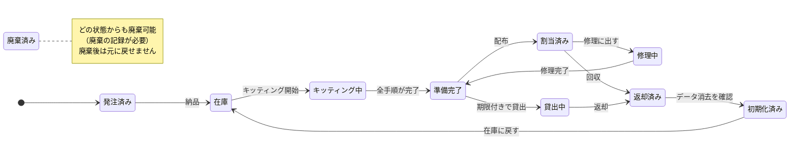
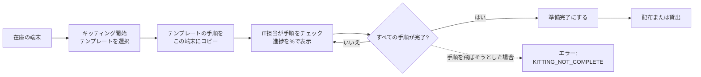
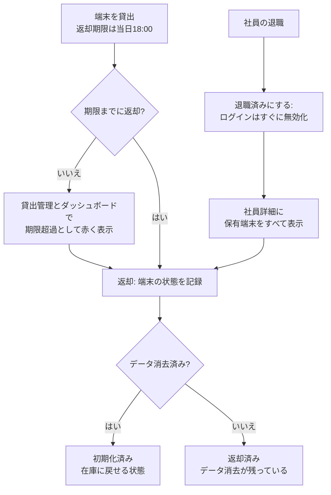
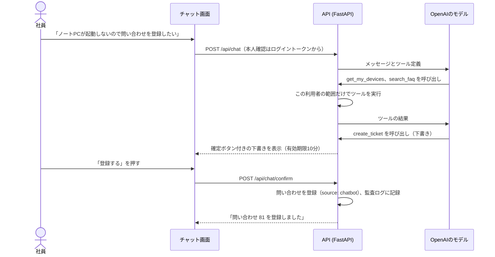
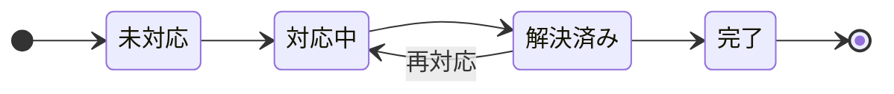
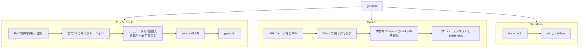

# ITSM 端末管理システム

**会社のPC・スマートフォンを購入から廃棄まで一元管理し、関連するヘルプデスク業務までまとめて扱える日英対応のWebシステムです。**

[](https://github.com/amishanita/itsm-platform/actions/workflows/ci.yml)


[English README](README.md)


| 684 | 49 | 13 | 12 | 476 | 2 |
| :---: | :---: | :---: | :---: | :---: | :---: |
| 自動テスト | APIエンドポイント | テーブル | 画面 | 翻訳済みの表示文言 | 対応言語 |

## 目次

1. [開発の背景](#開発の背景)
2. [このプロジェクトで示せるスキル](#このプロジェクトで示せるスキル)
3. [業務の流れ](#業務の流れ)
4. [ロールと権限](#ロールと権限)
5. [画面](#画面)
6. [システム構成とデータモデル](#システム構成とデータモデル)
7. [品質とテスト](#品質とテスト)
8. [セキュリティ](#セキュリティ)
9. [ローカルでの起動](#ローカルでの起動)
10. [運用ドキュメント](#運用ドキュメント)
11. [対象範囲と制約](#対象範囲と制約)
12. [今後の改善予定](#今後の改善予定)

## 開発の背景

私は日本でITヘルプデスクとして働いています。業務の多くは、Windows AutopilotとIntuneを使った
PC・スマートフォンのキッティング、資産台帳の更新、予備端末の貸出と返却期限を過ぎた端末の回収、
そして何度も寄せられる同じ質問への対応です。実際には、これらの情報がExcel、MDMの管理画面、
問い合わせツール、担当者の記憶に分散し、少しずつずれていきます。

このシステムは、端末まわりの業務を1か所にまとめ、普段手作業で守っている手順をシステム側で
担保するために作りました。キッティングごとのチェックリスト、データ消去を飛ばせないライフサイクル、
退職者が保有している端末をすべて一覧できる退職処理、そして「誰がいつ何を変更したか」の記録が中心です。

**デモ：** 現在は未公開です。Terraformのコードと構築手順書は準備済みで、サーバーを公開して動作を
確認した後にここへURLを記載します。

## このプロジェクトで示せるスキル

| 分野 | 取り組んだこと | 確認できる場所 |
| --- | --- | --- |
| **ITヘルプデスク** | ステータス・優先度・担当者・コメントを管理する問い合わせ対応フロー。実際のヘルプデスクでよくある質問をもとにした日英20件のFAQ。FAQを検索し、利用者の確認後に問い合わせを登録するチャットボット。 | [問い合わせ](docs/screenshots/09-ticket.png)、[FAQ](docs/screenshots/10-faq.png)、`backend/app/services/chatbot.py` |
| **IT資産管理** | ルールで制御された端末ライフサイクル、端末種別ごとのキッティングチェックリスト（Autopilot / Intune、iPhone、Android、共用端末の再キッティング）、返却期限付きの貸出、退職時の端末回収、保証終了の通知、CSVでの取り込み・出力、すべての変更履歴。 | [端末詳細](docs/screenshots/04-device-kitting.png)、[貸出管理](docs/screenshots/06-loans.png)、[退職処理](docs/screenshots/07-employee-leaver.png) |
| **社内SE・開発** | FastAPIとサービス層によるREST API、PostgreSQLとAlembicによるマイグレーション、ロールに応じたアクセス制御とSQLでの参照範囲の制御、フレームワークを使わない日英切り替え対応のフロントエンド。 | `backend/app/`、`frontend/` |
| **インフラ** | 開発・本番のDocker Compose、CaddyによるHTTPSの自動化、TerraformによるAWS構築（Lightsail、S3、IAM、予算アラート）、毎晩の暗号化バックアップと毎週のリストア確認。 | `docker-compose.prod.yml`、`infra/terraform/`、`scripts/` |
| **セキュリティ** | bcrypt、有効期限の短いJWT、回数制限、厳格なContent Security Policy、最小権限のIAM、秘密情報をGitとTerraformのstateに残さない設計。 | [セキュリティ](#セキュリティ) |
| **品質保証・運用** | 684件の自動テスト、ロール別の権限確認を含むPostmanコレクション、全画面のブラウザ確認、push時のCI、日本語の構築・運用・障害対応手順書。 | [品質とテスト](#品質とテスト)、[docs/](docs/) |

## 業務の流れ

### 1. 端末のライフサイクル

端末は決められた状態の間だけを移動します。図にない変更はAPIが `INVALID_STATUS_CHANGE` として
拒否し、すべての変更は監査ログに記録されます。



### 2. キッティング



テンプレートは、Windows（Autopilot / Intune）、iPhone・iPad、Android、共用端末の再キッティングの
4種類です。同じ端末を再キッティングしても、前回の記録は履歴として残ります。

### 3. 貸出・返却・退職処理



### 4. ヘルプデスクとチャットボット

チャットボットは、FAQの検索、本人の端末と問い合わせの確認、問い合わせの下書きができます。
自分で勝手に登録することはなく、利用者が10分以内に確定ボタンを押した場合だけ登録されます。



仕組み上のルール：モデルが利用者IDを指定することはできず（本人はトークンで判定）、会話履歴は
直近10件、ツールの呼び出しは1回の質問につき3回まで、利用は1人あたり1時間20回までです。

### 5. 問い合わせのステータス



## ロールと権限

| | システム管理者 | IT管理者 | マネージャー | 一般社員 |
| --- | :---: | :---: | :---: | :---: |
| 端末・キッティング・貸出 | 編集 | 編集 | 自部署を参照 | 自分の端末 |
| 社員・退職処理 | 編集 | 編集 | 自部署を参照 | |
| 問い合わせ | すべて | すべて | 自部署 | 自分の問い合わせ |
| FAQ | 編集 | 編集 | 参照 | 参照 |
| ダッシュボード | ○ | ○ | 自部署 | |
| ログインアカウント・監査ログ | ○ | | | |
| チャットボット | ○ | ○ | ○ | ○ |

参照範囲外のデータには403ではなく **404** を返し、存在自体を知られないようにしています。
ロールと有効・無効は、リクエストのたびにデータベースから読み直します。

## 画面

すべて、デモデータを入れた実際の画面です。

| | |
| --- | --- |
|  **端末一覧**（絞り込み・検索） |  **端末詳細**：実行できるステータス変更だけを表示、キッティングチェックリスト |
|  **キッティング状況**（担当者別） |  **貸出管理**（期限超過は赤） |
|  **退職処理**：回収する端末の一覧 |  **問い合わせ詳細**とコメント |
|  **FAQ**（利用者の言語で表示） |  **英語表示**（マネージャー） |
|  **サインイン** |  **スマートフォン表示**（375px） |

## システム構成とデータモデル


- インターネットから接続できるのはCaddyだけです。画面の配信、HTTPS化、セキュリティヘッダーの付与を
  行い、`/api` へのリクエストをFastAPIに渡します。
- APIとデータベースは別々のDockerネットワークに置き、データベース側は外部に出られない設定です。
- 業務ルールはサービス層にまとめているため、API・チャットボット・CSV取り込みのどこから操作しても
  同じチェックが働きます。


ER図はSQLAlchemyのモデル定義から [docs/diagrams/er_diagram.py](docs/diagrams/er_diagram.py) で
生成しているため、実際のテーブル構成と常に一致します。

| 分野 | 技術 |
| --- | --- |
| バックエンド | Python 3.12、FastAPI、SQLAlchemy 2、Alembic、Pydantic v2 |
| 認証 | JWT（PyJWT）、bcrypt、slowapiによる回数制限 |
| データベース | PostgreSQL 16 |
| フロントエンド | HTML、CSS、JavaScript（フレームワークなし）、Chart.js |
| チャットボット | OpenAI API（ツール呼び出し） |
| 配布・運用 | Docker Compose、Caddy、GitHub Actions |
| クラウド | AWS Lightsail、S3、IAM、Budgets（Terraformで管理） |
| テスト | pytest、Ruff、pip-audit、Postman / newman、Playwright |

## 品質とテスト



- **pytest 684件**で、ライフサイクルの全ルール、ロールと参照範囲、デモモードの制限、CSVの上限、
  擬似モデルを使ったチャットボットの流れ、FAQ検索を確認しています。テスト用データベース名の
  末尾が `_test` でなければテスト自体が起動しないため、本番データを消すことはありません。
- ルールを追加するたびに、わざとルールを壊してテストが失敗することも確認しました。
- **Postmanコレクション：** 44リクエスト、ロールごとの403確認を含む76項目
  （[docs/postman/](docs/postman/)）。
- **ブラウザでの確認：** 4つのロール × 2言語 × PCとスマートフォンの幅で全画面を開き（計192画面）、
  スクリプトエラーと翻訳漏れがないことを確認しました。
- **実環境での確認：** チャットボットは実際のOpenAI APIで、FAQを使った回答から問い合わせの下書き・
  確定・登録までを手動で確認しました。

## セキュリティ

- パスワードはbcryptで保存し、8～72バイト、切り詰めは行いません。ログインはIPごとに1分5回、
  チャットボットは1人あたり1時間20回までです。
- JWTにはユーザーIDだけを含めます。無効にしたユーザーは次のリクエストから利用できなくなります。
- 保護されたすべてのエンドポイントでロールを確認し、参照範囲はSQLの条件で制御します。
- エラーは常に `{"detail": {"code", "message"}}` の形式で返し、スタックトレースは出しません。
- CORSは1つのオリジンだけを許可します。画面は `unsafe-inline` を使わないContent Security Policyで
  配信し、データは `textContent` で表示します。
- 本番で開いているポートは80と443だけで、SSHは特定の1つのIPアドレスからのみ接続できます。
- 秘密情報はサーバーの `.env` に置き、Gitには含めません。バックアップ用のアクセスキーはTerraformの外で
  発行してstateに残さず、バックアップ用ユーザーにはバックアップの削除権限を与えていません。
- チャットボットのログには、エラーの種類とOpenAIのエラーコードだけを記録し、メッセージ本文は残しません。

## ローカルでの起動

Docker Desktopと、画面のファイルを配信するためのPython 3が必要です。

```bash
git clone https://github.com/amishanita/itsm-platform.git
cd itsm-platform
cp .env.example .env
```

`.env` を編集し、`POSTGRES_PASSWORD`（`DATABASE_URL` と `TEST_DATABASE_URL` の中も同じ値）、ランダムな
`JWT_SECRET`（`python3 -c "import secrets; print(secrets.token_urlsafe(64))"`）、8文字以上の
`DEMO_PASSWORD` を設定してから、次を実行します。

```bash
docker compose up -d --build
docker compose exec api alembic upgrade head
docker compose exec api python -m app.seed
python3 -m http.server 8080 -d frontend
```

http://localhost:8080 を開き、デモ用アカウントと設定した `DEMO_PASSWORD` でサインインします。

| ログインID | ロール |
| --- | --- |
| `admin@demo` | システム管理者 |
| `it@demo` | IT管理者 |
| `manager@demo` | マネージャー |
| `employee@demo` | 一般社員 |

APIドキュメント：http://localhost:8000/api/docs

**チャットボット（任意）：** `OPENAI_API_KEY` と、ツール呼び出しに対応したモデル名を `OPENAI_MODEL` に
設定します。新しいOpenAIモデルでは `OPENAI_REASONING_EFFORT=none` も必要です。設定後に
`docker compose up -d api` を実行してください。

**テスト：**

```bash
cd backend
python3.12 -m venv .venv && source .venv/bin/activate
pip install -r requirements-dev.txt
export DATABASE_URL=postgresql+psycopg://itsm:<password>@localhost:5432/itsm
export TEST_DATABASE_URL=postgresql+psycopg://itsm:<password>@localhost:5432/itsm_test
pytest -q
```

## 運用ドキュメント

実際にこのシステムを運用する担当者向けに、ビジネス日本語で作成しています。

| ドキュメント | 内容 |
| --- | --- |
| [構築手順書](docs/構築手順書.md) | サーバーの新規構築：Terraform、Docker、HTTPS、cron、初回バックアップ |
| [運用手順書](docs/運用手順書.md) | 定期確認、バックアップ、リストア、再起動、ユーザー追加、アップデート |
| [障害対応手順書](docs/障害対応手順書.md) | サイトに接続できない、ディスク不足、証明書エラー、チャットボットが応答しない |
| [infra/terraform/README.md](infra/terraform/README.md) | AWSリソース、費用、構築後の確認（英語） |

## 対象範囲と制約

- AutopilotとIntuneの項目は手入力です。Microsoft Graphとの連携はまだありません。
- 「データ消去済み」は担当者が消去したことの記録で、アプリが端末を消去するわけではありません。
- 氏名、問い合わせ本文、シリアル番号、備考は翻訳しません。翻訳するのは画面の表示だけです。
- CSVの取り込み・出力、パスワード変更、監査ログはAPIで利用できますが、画面はまだありません。
- 本番サーバーはデモモードで運用します。デモデータは毎晩初期状態に戻り、本格的な本番運用向けに
  最初の管理者を作成するコマンドはまだありません。
- 公開デモでは運用費をかけないため、チャットボットを停止しています。

## 今後の改善予定

1. Microsoft Graph経由でIntuneからコンプライアンス状態を取得し、手入力をなくす。
2. Microsoft Entra IDでのサインインに対応し、トークンをHttpOnly Cookieで扱う。
3. CSV取り込み、パスワード変更、監査ログの画面を作る。
4. 返却期限超過と保証終了が近い端末をメールで通知する。
5. PlaywrightのブラウザテストをCIに組み込み、死活監視とアラートを追加する。
6. 最初の管理者を作成するコマンドを追加し、デモモード以外でも運用できるようにする。

## 作成者

**Tamang Amish**　ITヘルプデスク（日本）　[GitHub](https://github.com/amishanita)
