# ITSM 端末管理システム

会社のPC・スマートフォンを、購入からキッティング、配布、貸出、返却、データ消去、廃棄まで一元管理する
日英対応のWebアプリです。端末に関わるヘルプデスク業務（問い合わせチケット、FAQ、チケットを起票できる
チャットボット）もあわせて扱います。

[English README](README.md)

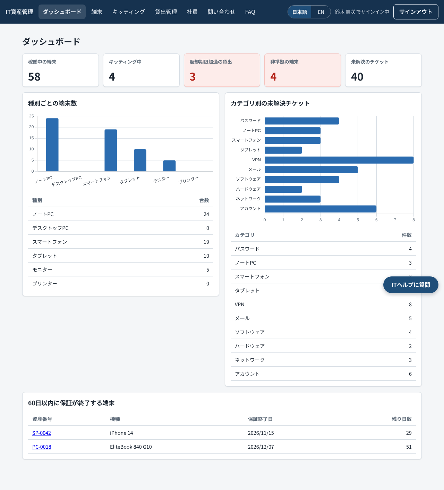

## デモ

現在は未公開です。サーバー構成、Terraform、構築手順（[docs/構築手順書.md](docs/構築手順書.md)）は準備済みで、
公開して動作を確認した後にここへURLを記載します。

デモ用アカウント（パスワードはデモデータ投入時の `DEMO_PASSWORD` で設定します）：

| ログインID | ロール | できること |
| --- | --- | --- |
| `admin@demo` | super_admin | すべての操作、ログインアカウント管理、監査ログ |
| `it@demo` | it_admin | 端末、キッティング、貸出、社員、問い合わせ、FAQの管理 |
| `manager@demo` | manager | 自部署の参照、ダッシュボード |
| `employee@demo` | employee | 自分の端末と問い合わせ、FAQ、チャットボット |

## 作った理由

私は日本でITヘルプデスクとして働いています。業務の多くは、Windows AutopilotとIntuneを使ったPC・
スマートフォンのキッティング、資産台帳の更新、予備端末の貸出と返却期限を過ぎた端末の回収、そして
何度も寄せられる同じ質問への対応です。実際には、これらの情報がExcel、MDMの管理画面、問い合わせ
ツール、担当者の記憶に分散しがちです。

このシステムは、端末まわりの業務を1か所にまとめるために、私が実際に行っている手順をもとに作りました。
端末種別ごとのキッティングチェックリスト、データ消去を飛ばせないライフサイクル、退職者が保有している
端末をすべて一覧できる退職処理、そして「誰がいつ何を変更したか」を残す監査ログが中心です。

## 画面

すべて、デモデータを入れた実際の画面です。

| | |
| --- | --- |
| 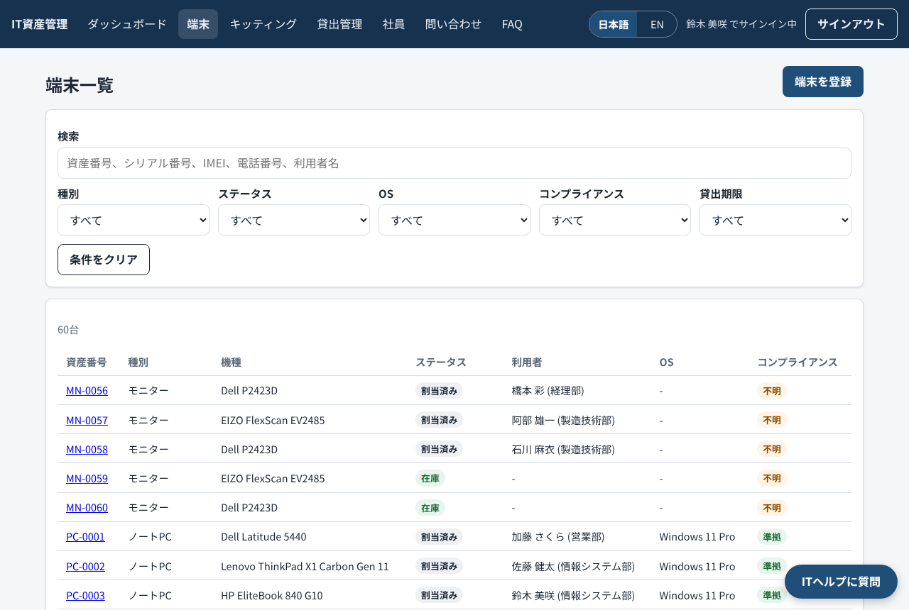 端末一覧（絞り込み・検索） | 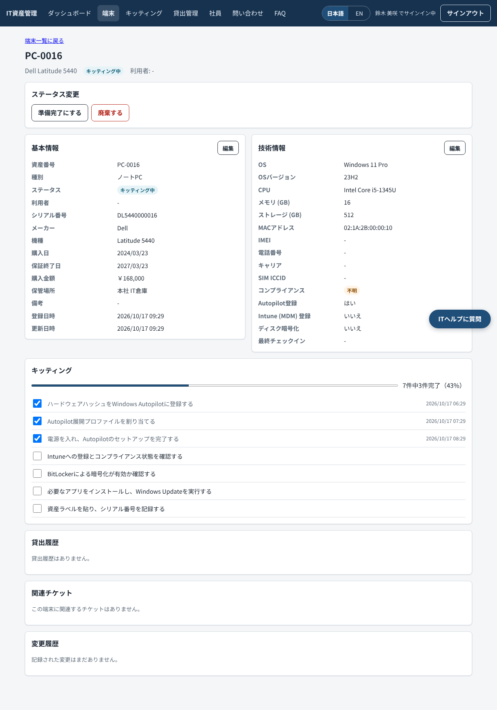 端末詳細：実行できるステータス変更だけを表示、キッティングチェックリスト |
| 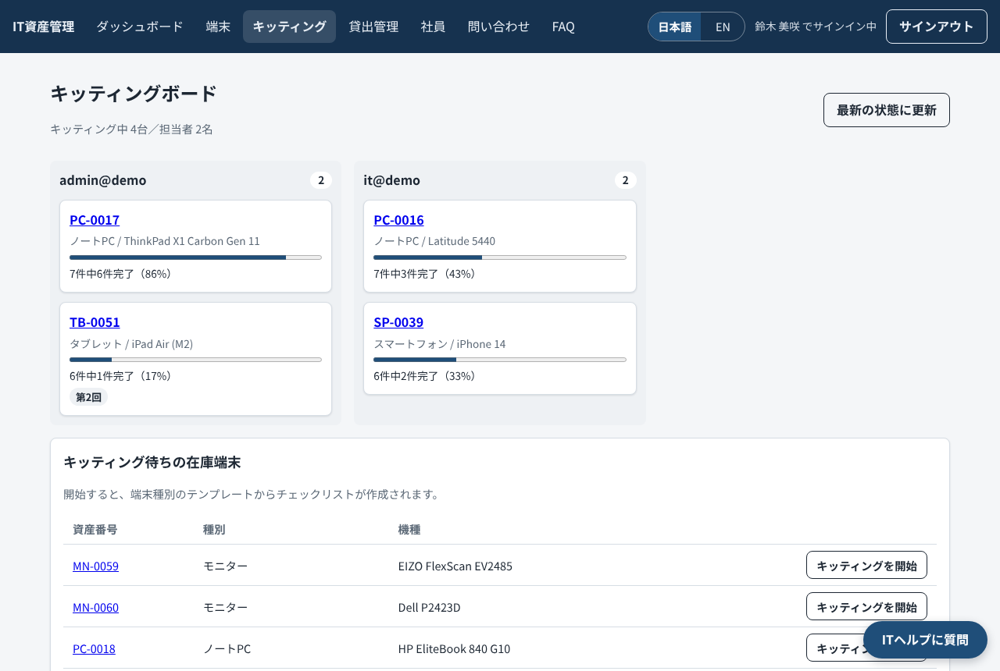 担当者別のキッティング状況 | 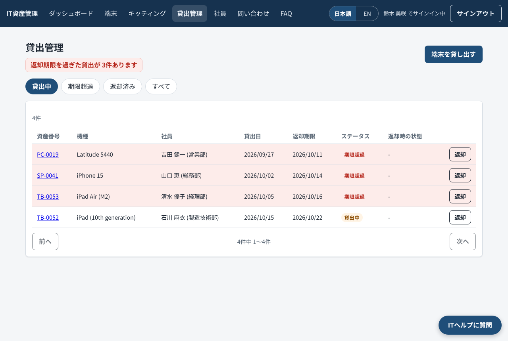 貸出管理（期限超過は赤で表示） |
| 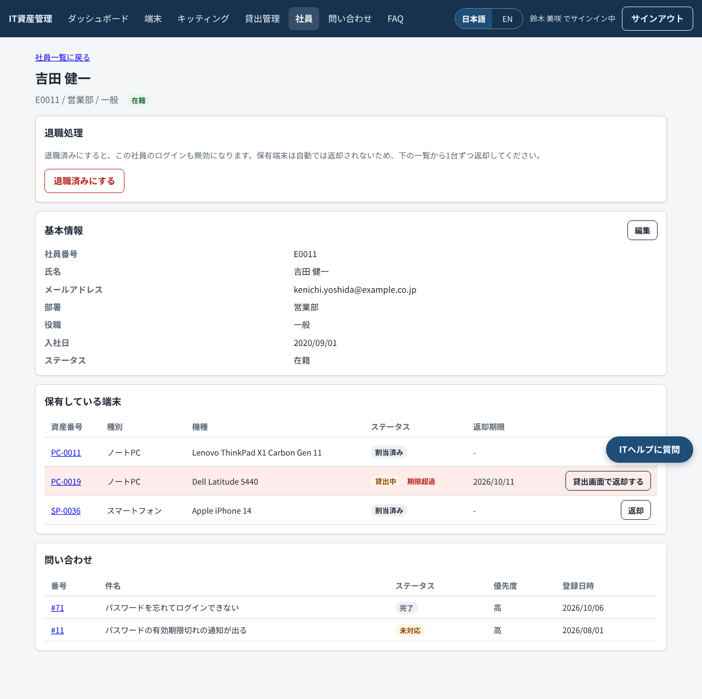 社員詳細：退職時に回収する端末の一覧 | 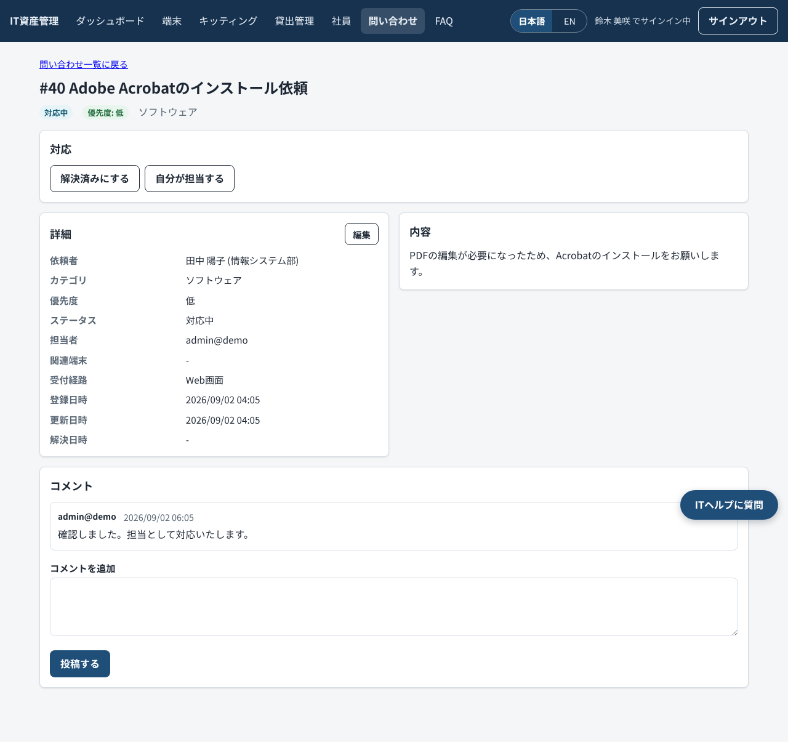 問い合わせ詳細とコメント |
| 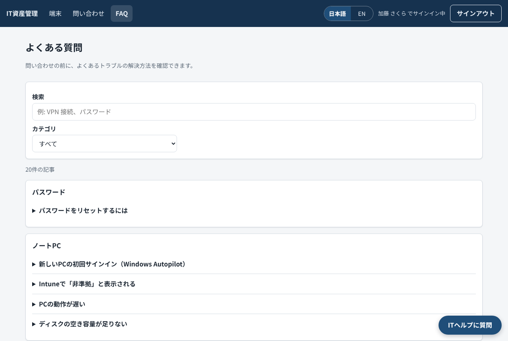 利用者の言語で表示するFAQ | 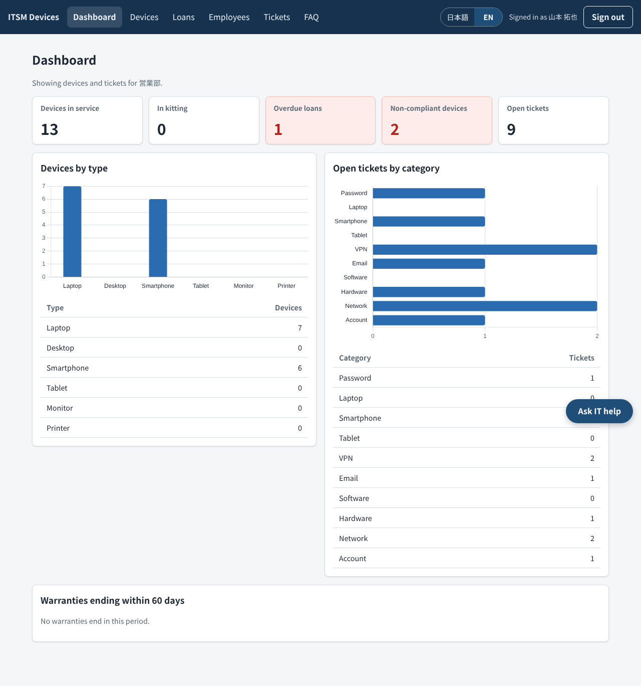 英語表示（マネージャー） |

## 主な機能

**端末とキッティング**
- 端末台帳（ノートPC、スマートフォン、タブレット、モニター）。OS、IMEI、電話番号、SIM、MDM登録、
  暗号化、コンプライアンス状態などの技術情報も管理します。
- 決められた順序だけを許可するライフサイクル：`ordered → in_stock → kitting → ready → assigned / on_loan
  → returned → wiped → in_stock`、および `repair` と `retired`。それ以外の変更はエラーになります。
- 端末種別ごとのテンプレート（Windows Autopilot / Intune、iPhone・iPad、Android、共用端末の再キッティング）
  からチェックリストを作成します。すべての手順が完了するまで「準備完了」にはできません。再キッティング時も
  前回の記録は履歴として残ります。

**貸出と退職処理**
- 返却期限を決めて端末を貸し出し、期限を過ぎたものは強調表示します。返却時は端末の状態とデータ消去の有無を記録します。
- 社員詳細では、その社員が保有している端末をすべて表示し、1台ずつ返却できます（割当端末はその画面から、
  貸出端末は貸出記録から返却）。

**ヘルプデスク**
- 問い合わせチケット：ステータス、優先度、担当者、コメント、関連端末。社員は自分のチケットだけ、
  マネージャーは自部署のチケットを参照できます。
- 日英20件のFAQ。利用者の言語で検索でき、IT担当者は両言語を並べて編集できます。
- チャットボット（OpenAIのツール呼び出し）。FAQの検索、自分の端末や問い合わせ状況の確認を行い、
  必要に応じてチケットの下書きを作ります。チケットは利用者が確認してから作成されます。

**その他**
- ダッシュボード：種別・ステータス別の端末数、キッティング進捗、返却期限超過、非準拠端末、
  60日以内の保証終了、カテゴリ別の未解決チケット。
- 日本語・英語の切り替え（ユーザーごとに保存、初期値は日本語）。
- すべての変更を記録する監査ログと、端末ごとの変更履歴。

**現時点ではAPIのみ（画面は未作成）：** 端末のCSV取り込み・出力、パスワード変更、監査ログ一覧
（`GET /api/audit-logs`）。いずれもテストとPostmanコレクションで確認しています。

### このバージョンでできないこと

- AutopilotとIntuneの項目は手入力です。Microsoft Graphとは連携していません。
- 「データ消去済み」は、担当者が消去したことを記録するものです。アプリが端末を消去するわけではありません。
- 氏名、問い合わせ本文、シリアル番号、備考は翻訳しません。翻訳するのは画面の表示だけです。
- チャットボットはpytestで擬似モデルを使ってテストし、実際のOpenAI API（`gpt-6-luna`、
  `OPENAI_REASONING_EFFORT=none`）でも手動で確認しました（FAQを使った回答、問い合わせの下書き・確定・登録）。
  公開デモでは運用費をかけないため停止しています。

## 使用技術

| 分野 | 技術 |
| --- | --- |
| バックエンド | Python 3.12、FastAPI、SQLAlchemy 2、Alembic、Pydantic v2 |
| 認証 | JWT（PyJWT）、bcrypt、slowapiによる回数制限 |
| データベース | PostgreSQL 16 |
| フロントエンド | HTML、CSS、JavaScript（フレームワークなし）、Chart.js |
| チャットボット | OpenAI API（ツール呼び出し） |
| テスト・品質 | pytest、Ruff、pip-audit、Postman / newman |
| 配布・運用 | Docker Compose、GitHub Actions、Caddy（HTTPS） |
| クラウド | AWS Lightsail、S3、Terraform |

## 構成図

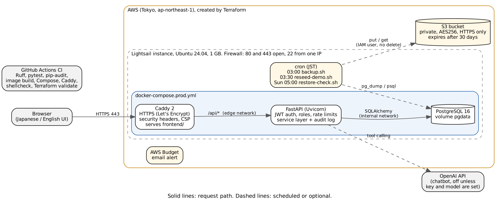

インターネットから接続できるのはCaddyだけです。APIとデータベースは別々のDockerネットワークに置き、
データベース側のネットワークは外部に出られない設定にしています。元データ：
[docs/diagrams/architecture.dot](docs/diagrams/architecture.dot)

## データモデル

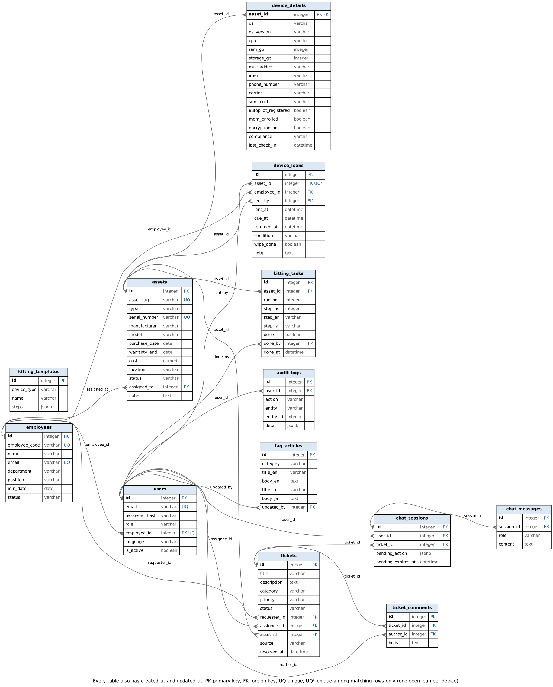

SQLAlchemyのモデル定義から [docs/diagrams/er_diagram.py](docs/diagrams/er_diagram.py) で生成しているため、
実際のテーブル構成と一致します。

## ローカルでの起動

Docker Desktopと、フロントエンドのファイルを配信するためのPython 3が必要です。

```bash
git clone https://github.com/amishanita/itsm-platform.git
cd itsm-platform
cp .env.example .env
```

`.env` を編集し、`POSTGRES_PASSWORD`（`DATABASE_URL` と `TEST_DATABASE_URL` の中のパスワードも同じ値）、
ランダムな `JWT_SECRET`（`python3 -c "import secrets; print(secrets.token_urlsafe(64))"`）、
8文字以上の `DEMO_PASSWORD` を設定します。その後、次を実行します。

```bash
docker compose up -d --build
docker compose exec api alembic upgrade head
docker compose exec api python -m app.seed
python3 -m http.server 8080 -d frontend
```

http://localhost:8080 を開き、`it@demo` と設定した `DEMO_PASSWORD` でサインインします。
APIドキュメントは http://localhost:8000/api/docs です。チャットボットを試す場合は、ご自身の
`OPENAI_API_KEY` と、ツール呼び出しに対応したモデル名を `OPENAI_MODEL` に設定し、もう一度
`docker compose up -d` を実行してください。新しいOpenAIモデルでは `OPENAI_REASONING_EFFORT=none` も設定してください
（設定しないと、このエンドポイントでのツール呼び出しが拒否されます）。

## テスト

```bash
cd backend
python3.12 -m venv .venv && source .venv/bin/activate
pip install -r requirements-dev.txt
export DATABASE_URL=postgresql+psycopg://itsm:<password>@localhost:5432/itsm
export TEST_DATABASE_URL=postgresql+psycopg://itsm:<password>@localhost:5432/itsm_test
pytest -q
ruff check . && ruff format --check .
```

`TEST_DATABASE_URL` の末尾が `_test` で、かつ `DATABASE_URL` と異なる場合しかテストは起動しないため、
本番データを消すことはありません。執筆時点で684件のテストがあり、ライフサイクルの全ルール、ロールと
参照範囲の確認、デモモードの制限、CSVの上限、擬似モデルを使ったチャットボットの流れ、FAQ検索などを
確認しています。

**CI（GitHub Actions）** では、Ruff、空のデータベースへのマイグレーション、デモデータ投入を2回実行して
件数が変わらないことの確認、pytest、pip-audit、Dockerイメージのビルドと非rootユーザーでの実行確認、
本番用ComposeファイルとCaddyfileの検証、サーバースクリプトのshellcheck、`terraform fmt` / `validate` を
実行します。

**PostmanによるAPIテスト：** [docs/postman/itsm.postman_collection.json](docs/postman/itsm.postman_collection.json)
と `ITSM local` 環境をインポートし、`demo_password` を設定してコレクションを実行します（44リクエスト、
ロールによる403の確認を含む76項目）。コマンドラインからは次のとおりです。
`npx newman run docs/postman/itsm.postman_collection.json -e docs/postman/itsm-local.postman_environment.json --env-var demo_password=...`

**ブラウザでの確認：** 各画面の作成時に、実際のAPIに対してPlaywrightのスクリプトで確認しました
（ロール別のメニュー、375pxのスマートフォン表示、言語切り替え、エラー表示など）。CIにはまだ組み込んでいません。

## セキュリティ

- パスワードはbcryptで保存します。8～72バイトで、切り詰めは行いません。ログインはIPごとに1分5回、
  チャットはユーザーごとに1時間20回までです。
- JWTに含めるのはユーザーIDだけです。ロールと有効・無効はリクエストのたびにデータベースから読むため、
  無効にしたユーザーはすぐに利用できなくなります。
- 参照範囲の制御はSQLの条件で行います。範囲外のデータには403ではなく404を返し、存在自体を知られないようにしています。
- エラーは常に `{"detail": {"code", "message"}}` の形式で返し、スタックトレースは出しません。
- CORSは1つのオリジンだけを許可します。画面は `unsafe-inline` を使わないContent Security Policyで配信し、
  データは `textContent` で表示します。
- HSTSなどのセキュリティヘッダーはCaddyで付与し、外部に開いているのはCaddyのポートだけです。SSHは
  特定の1つのIPアドレスからのみ接続できます。
- 秘密情報はサーバーの `.env` に置き、リポジトリには含めません。Terraformのstateと `terraform.tfvars` も
  Gitの対象外です。バックアップ用のアクセスキーはTerraformの外で発行し、stateファイルに残らないようにしています。
- バックアップは毎晩暗号化してS3へ保存し、30日で自動削除します。毎週、最新のバックアップを別のデータベースに
  復元して、実際に戻せることを確認します。バックアップ用ユーザーには削除権限がありません。
- デモモードでは4つのデモアカウントは変更できず、データは毎晩初期状態に戻ります。

## 今後の改善予定

1. Microsoft Graph経由でIntuneからコンプライアンス状態を取得し、手入力をなくす。
2. Microsoft Entra IDでのサインインに対応し、トークンの保存先をsessionStorageからHttpOnly Cookieへ移す。
3. CSV取り込み、パスワード変更、監査ログの画面を作る。
4. 返却期限超過と保証終了が近い端末をメールで通知する。
5. PlaywrightのブラウザテストをCIに組み込み、死活監視とアラートを追加する。
6. 複数人で作業できるよう、TerraformのstateをS3に置いてロックをかける。
7. 最初の管理者アカウントを作成するコマンドを追加し、`APP_ENV=production` で運用できるようにする
   （現在はデモデータの投入が本番モードでは拒否されるため、デモモードで構築しています）。

## ドキュメント

- [構築手順書](docs/構築手順書.md)：サーバーを一から構築する手順
- [運用手順書](docs/運用手順書.md)：バックアップ、リストア、再起動、ユーザー追加、アップデート
- [障害対応手順書](docs/障害対応手順書.md)：サイトに接続できない、ディスク不足、証明書エラー、チャットボットが応答しない

## 作成者

Tamang Amish（[GitHub](https://github.com/amishanita)）
