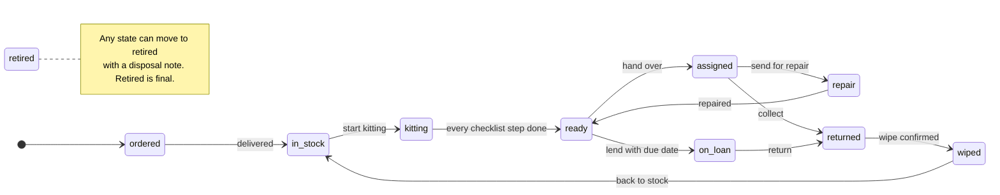
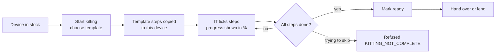
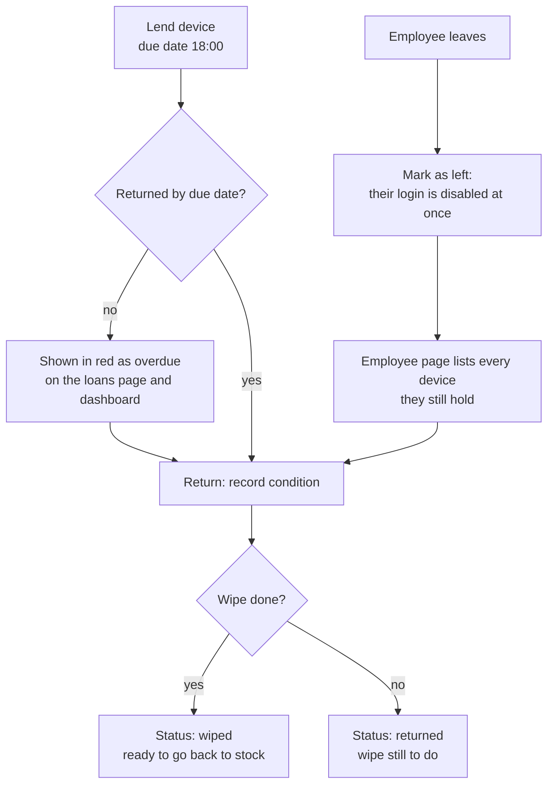
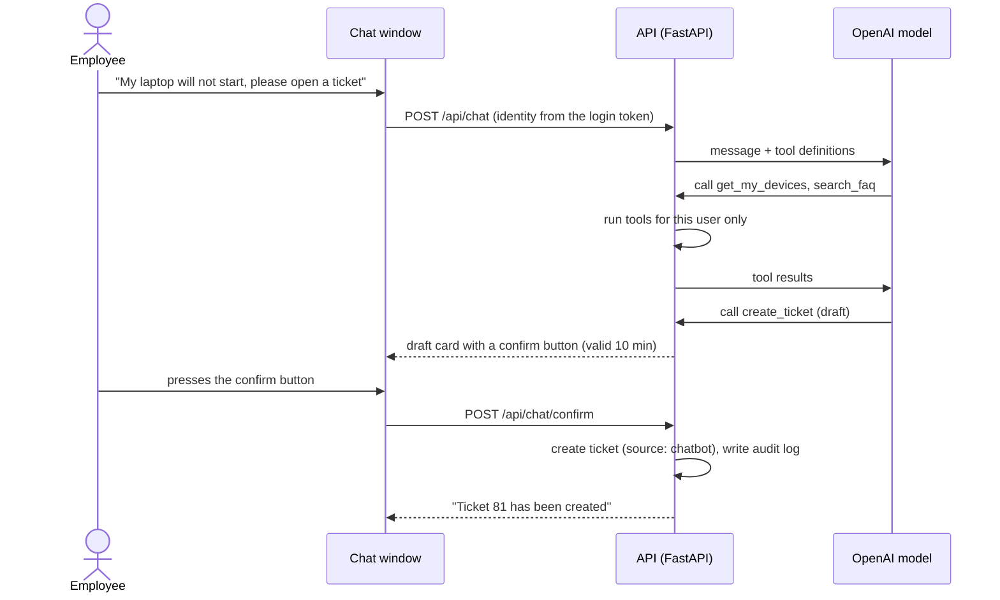
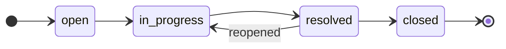
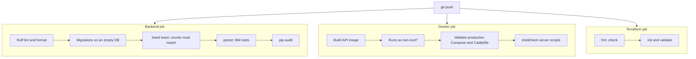

# ITSM Device Management

**A bilingual (Japanese / English) system for managing company PCs and phones from purchase to disposal, with the helpdesk work around them.**

[](https://github.com/amishanita/itsm-platform/actions/workflows/ci.yml)


[日本語のREADMEはこちら](README.ja.md)


| 684 | 49 | 13 | 12 | 476 | 2 |
| :---: | :---: | :---: | :---: | :---: | :---: |
| automated tests | API operations | database tables | screens | translated UI strings | languages |

## Contents

1. [Why I built this](#why-i-built-this)
2. [Skills this project shows](#skills-this-project-shows)
3. [How the work flows](#how-the-work-flows)
4. [Who can do what](#who-can-do-what)
5. [Screenshots](#screenshots)
6. [Architecture and data model](#architecture-and-data-model)
7. [Quality: how it is tested](#quality-how-it-is-tested)
8. [Security](#security)
9. [Run it locally](#run-it-locally)
10. [Operations documents (Japanese)](#operations-documents-japanese)
11. [Scope and limits](#scope-and-limits)
12. [What I would build next](#what-i-would-build-next)

## Why I built this

I work in IT helpdesk in Japan. Most of my day is kitting PCs and phones with Windows Autopilot
and Intune, keeping the asset list correct, lending spare devices and chasing the ones that come
back late, and answering the same questions again and again. In practice that information lives
in a spreadsheet, an MDM console, a ticket tool, and people's memory, and it drifts apart.

This system puts the device side of that work in one place and enforces the steps I follow by
hand: a checklist for every kitting job, a lifecycle that will not let a device skip the wipe,
a leaver flow that lists everything a person still holds, and a record of who changed what.

**Live demo:** not deployed yet. The Terraform code and the Japanese setup guide are ready; the
link will be added here once the server is up and checked.

## Skills this project shows

| Area | What I did | Where to look |
| --- | --- | --- |
| **IT helpdesk** | Ticket workflow with status, priority, assignee, and comments. 20 FAQ articles in both languages, written from real helpdesk questions. A chatbot that searches the FAQ and drafts a ticket the user confirms. | [Tickets](docs/screenshots/09-ticket.png), [FAQ](docs/screenshots/10-faq.png), `backend/app/services/chatbot.py` |
| **IT asset management** | Device lifecycle with enforced rules, kitting checklists per device type (Autopilot / Intune, iPhone, Android, shared device re-kit), loans with due dates, leaver device collection, warranty alerts, CSV import and export, full audit history. | [Device page](docs/screenshots/04-device-kitting.png), [Loans](docs/screenshots/06-loans.png), [Leaver flow](docs/screenshots/07-employee-leaver.png) |
| **社内SE / development** | REST API with FastAPI and a service layer, PostgreSQL with Alembic migrations, role-based access with data scoping in SQL, a framework-free frontend with full Japanese / English switching. | `backend/app/`, `frontend/` |
| **Infrastructure** | Docker Compose for local and production, Caddy for automatic HTTPS, Terraform for AWS (Lightsail, S3, IAM, Budgets), nightly encrypted backups with a weekly restore test. | `docker-compose.prod.yml`, `infra/terraform/`, `scripts/` |
| **Security** | bcrypt, short-lived JWT, rate limits, strict Content Security Policy, least-privilege IAM, secrets kept out of Git and out of Terraform state. | [Security](#security) |
| **QA and operations** | 684 automated tests, a Postman collection with role checks, browser checks of every screen, CI on every push, and Japanese runbooks for setup, operations, and incidents. | [Quality](#quality-how-it-is-tested), [docs/](docs/) |

## How the work flows

### 1. Device lifecycle

Every device moves through fixed states. Any change outside these arrows is refused by the API
with `INVALID_STATUS_CHANGE`, and every change is written to the audit log.



### 2. Kitting



Templates exist for Windows (Autopilot / Intune), iPhone and iPad, Android, and shared-device
re-kit. When a device is kitted again, the earlier run stays as history.

### 3. Loans, returns, and leavers



### 4. Helpdesk and chatbot

The chatbot can search the FAQ, look up the user's own devices and tickets, and prepare a ticket.
It never creates anything by itself: the user has to confirm, within 10 minutes.



Rules behind it: the model can never pass a user id (identity always comes from the token),
history is limited to 10 messages, tool rounds to 3, and each user to 20 messages an hour.

### 5. Ticket status



## Who can do what

| | super_admin | it_admin | manager | employee |
| --- | :---: | :---: | :---: | :---: |
| Devices, kitting, loans | edit | edit | read, own department | own devices |
| Employees and leaver flow | edit | edit | read, own department | |
| Tickets | all | all | own department | own tickets |
| FAQ | edit | edit | read | read |
| Dashboard | yes | yes | own department | |
| Login accounts, audit log | yes | | | |
| Chatbot | yes | yes | yes | yes |

Records outside a user's scope return **404**, not 403, so their existence is not revealed.
The role and active flag are read from the database on every request.

## Screenshots

All taken from the running application with the demo data.

| | |
| --- | --- |
|  **Device list** with filters and search |  **Device page**: only allowed status changes, kitting checklist |
|  **Kitting board** by person |  **Loans**, overdue in red |
|  **Leaver flow**: devices to collect |  **Ticket** with comments |
|  **FAQ** in the reader's language |  **English UI**, manager view |
|  **Sign-in** |  **Phone layout** (375 px) |

## Architecture and data model


- Only Caddy is reachable from the internet. It serves the frontend, adds HTTPS and security
  headers, and passes `/api` to FastAPI.
- The API and the database sit on separate Docker networks; the database network has no route out.
- Business rules live in a service layer, so the API, the chatbot tools, and CSV import all go
  through the same checks.


The ER diagram is generated from the SQLAlchemy models by
[docs/diagrams/er_diagram.py](docs/diagrams/er_diagram.py), so it always matches the real schema.

| Layer | Technology |
| --- | --- |
| Backend | Python 3.12, FastAPI, SQLAlchemy 2, Alembic, Pydantic v2 |
| Auth | JWT (PyJWT), bcrypt, slowapi rate limits |
| Database | PostgreSQL 16 |
| Frontend | HTML, CSS, JavaScript modules (no framework), Chart.js |
| Chatbot | OpenAI API with tool calling |
| Delivery | Docker Compose, Caddy, GitHub Actions |
| Cloud | AWS Lightsail, S3, IAM, Budgets, managed with Terraform |
| Testing | pytest, Ruff, pip-audit, Postman / newman, Playwright |

## Quality: how it is tested



- **684 pytest tests** cover every lifecycle rule, every role and scope check, demo-mode locks,
  CSV limits, the chatbot loop with a scripted model, and FAQ search. The test suite refuses to run
  unless its database name ends in `_test`, so it can never wipe real data.
- When I added a rule, I also broke it on purpose and checked that a test failed.
- **Postman collection:** 44 requests and 76 assertions, including the 403 checks for each role
  ([docs/postman/](docs/postman/)).
- **Browser checks:** every screen opened as each of the 4 roles, in both languages, at desktop and
  phone width (192 page visits), with no script errors and no missing translations.
- **Live check:** the chatbot was tested by hand against the real OpenAI API, from an FAQ answer
  to a ticket drafted, confirmed, and created.

## Security

- Passwords hashed with bcrypt, 8 to 72 bytes, never truncated. Login limited to 5 tries a minute
  per IP, the chatbot to 20 messages an hour per user.
- The JWT holds only the user id; a deactivated user is locked out on their next request.
- Every protected endpoint checks the role, and data scoping is done in the SQL query.
- Errors always use one format, `{"detail": {"code", "message"}}`, with no stack traces.
- CORS allows one origin. Pages use a Content Security Policy without `unsafe-inline`, and all
  data is written with `textContent`.
- In production only ports 80 and 443 are open; SSH is open to one IP address.
- Secrets live in `.env` on the server and never in Git. The backup access key is created outside
  Terraform so it never lands in the state file, and the backup user cannot delete backups.
- The chatbot log records only the error type and OpenAI's error code, never message text.

## Run it locally

You need Docker Desktop and Python 3 (only to serve the frontend files).

```bash
git clone https://github.com/amishanita/itsm-platform.git
cd itsm-platform
cp .env.example .env
```

Edit `.env`: set `POSTGRES_PASSWORD` (the same value inside `DATABASE_URL` and
`TEST_DATABASE_URL`), a random `JWT_SECRET` (`python3 -c "import secrets; print(secrets.token_urlsafe(64))"`),
and a `DEMO_PASSWORD` of at least 8 characters. Then:

```bash
docker compose up -d --build
docker compose exec api alembic upgrade head
docker compose exec api python -m app.seed
python3 -m http.server 8080 -d frontend
```

Open http://localhost:8080 and sign in with one of the demo logins and your `DEMO_PASSWORD`:

| Login | Role |
| --- | --- |
| `admin@demo` | super_admin |
| `it@demo` | it_admin |
| `manager@demo` | manager |
| `employee@demo` | employee |

API documentation: http://localhost:8000/api/docs

**Chatbot (optional):** set `OPENAI_API_KEY` and a model with tool calling in `OPENAI_MODEL`. Newer
OpenAI models also need `OPENAI_REASONING_EFFORT=none`. Then run `docker compose up -d api`.

**Tests:**

```bash
cd backend
python3.12 -m venv .venv && source .venv/bin/activate
pip install -r requirements-dev.txt
export DATABASE_URL=postgresql+psycopg://itsm:<password>@localhost:5432/itsm
export TEST_DATABASE_URL=postgresql+psycopg://itsm:<password>@localhost:5432/itsm_test
pytest -q
```

## Operations documents (Japanese)

Written in business Japanese for the people who would run this system.

| Document | Contents |
| --- | --- |
| [構築手順書](docs/構築手順書.md) | Building the server from scratch: Terraform, Docker, HTTPS, cron, first backup |
| [運用手順書](docs/運用手順書.md) | Daily checks, backup, restore, restart, adding users, updates |
| [障害対応手順書](docs/障害対応手順書.md) | Site down, disk full, certificate errors, chatbot not answering |
| [infra/terraform/README.md](infra/terraform/README.md) | AWS resources, cost, and checks after apply (English) |

## Scope and limits

- Autopilot and Intune fields are typed in by hand; there is no Microsoft Graph connection yet.
- "Wipe confirmed" records that an operator wiped the device. The app does not erase anything.
- Names, ticket text, serial numbers, and notes are not translated; only the interface is.
- CSV import and export, password change, and the audit log are available in the API but have no
  screen yet.
- The production server runs in demo mode: the demo data resets every night, and there is no
  command yet to create the first admin for a real production setup.
- The chatbot is switched off on the public demo to keep the running cost at zero.

## What I would build next

1. Read device compliance from Intune through Microsoft Graph instead of typing it in.
2. Sign-in with Microsoft Entra ID, with the token in an HttpOnly cookie.
3. Screens for CSV import, password change, and the audit log.
4. Email reminders for overdue loans and warranties ending soon.
5. Playwright browser checks in CI, and uptime monitoring with alerts.
6. A command to create the first admin, so the system can run outside demo mode.

## Author

**Tamang Amish** | IT helpdesk, Japan | [GitHub](https://github.com/amishanita)
