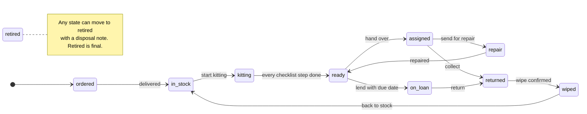
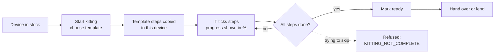
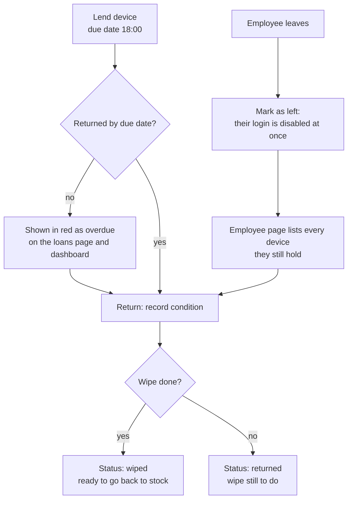
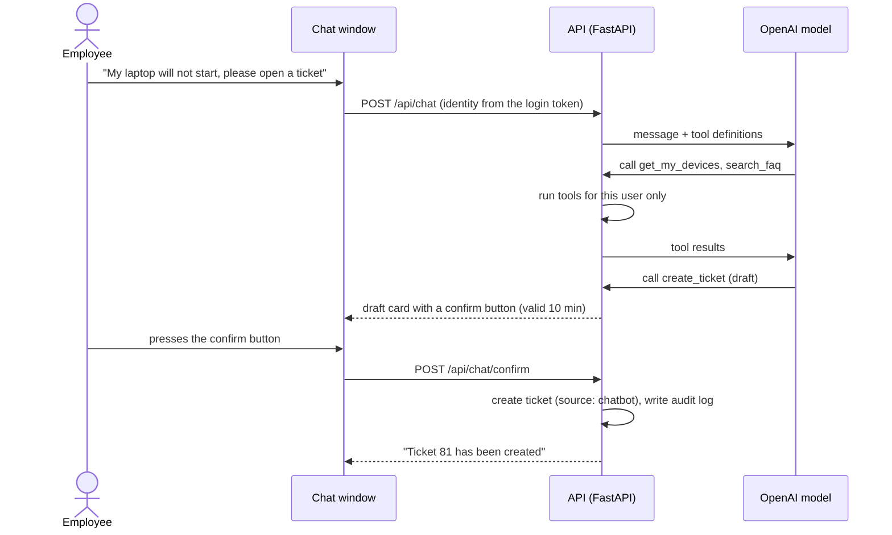
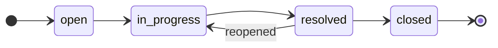
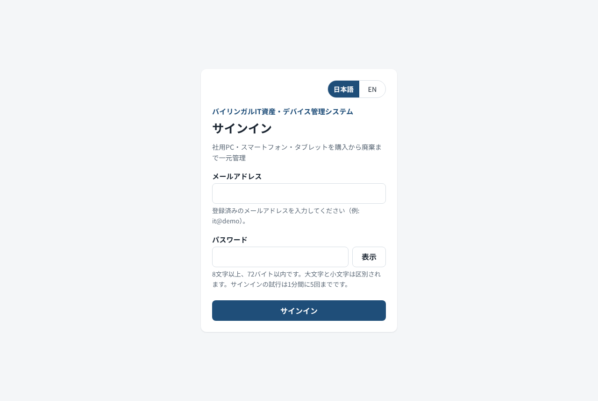
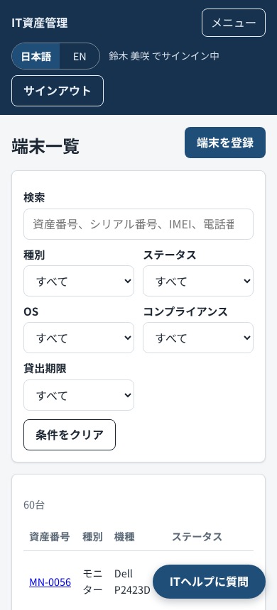
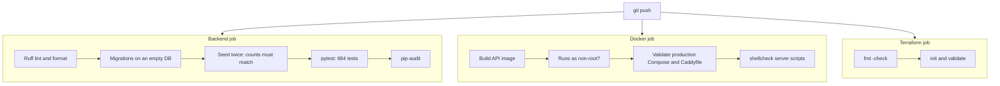
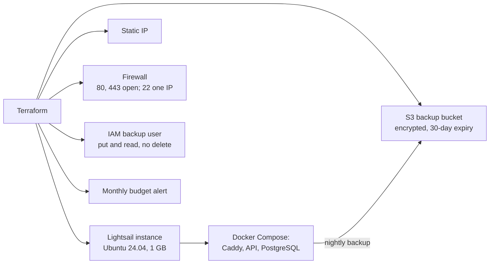

# Bilingual ITSM Device Management System

**日英対応 IT資産・デバイス管理システム**

A web system, in Japanese and English, for managing company PCs, smartphones, and tablets
through their whole life (purchase, kitting, handover, loans, returns, wipe, and disposal),
together with the helpdesk work around them: tickets, an FAQ, and a chatbot that can open tickets.

[](https://github.com/amishanita/bilingual-itsm-device-management-system/actions/workflows/ci.yml)


[日本語のREADMEはこちら](README.ja.md)


| 684 | 49 | 13 | 12 | 476 | 2 |
| :---: | :---: | :---: | :---: | :---: | :---: |
| automated tests | API operations | database tables | screens | translated UI strings | languages |

## Contents

1. [Why I built this](#why-i-built-this)
2. [Skills this project shows](#skills-this-project-shows)
3. [Features by screen](#features-by-screen)
4. [How the work flows](#how-the-work-flows)
5. [Who can do what](#who-can-do-what)
6. [Screenshots](#screenshots)
7. [Architecture and data model](#architecture-and-data-model)
8. [API reference](#api-reference)
9. [Quality: how it is tested](#quality-how-it-is-tested)
10. [Security](#security)
11. [Run it locally](#run-it-locally)
12. [Configuration](#configuration)
13. [Demo data](#demo-data)
14. [Deploying to AWS](#deploying-to-aws)
15. [Project structure](#project-structure)
16. [Operations documents (Japanese)](#operations-documents-japanese)
17. [Scope and limits](#scope-and-limits)
18. [What I would build next](#what-i-would-build-next)

## Why I built this

I work in IT helpdesk in Japan. Most of my day is kitting PCs and phones with Windows Autopilot
and Intune, keeping the asset list correct, lending spare devices and chasing the ones that come
back late, and answering the same questions again and again. In practice that information lives
in a spreadsheet, an MDM console, a ticket tool, and people's memory, and it drifts apart.

This system puts the device side of that work in one place and enforces the steps I follow by
hand: a checklist for every kitting job, a lifecycle that will not let a device skip the wipe,
a leaver flow that lists everything a person still holds, and a record of who changed what.

**Live demo:** not deployed yet. The Terraform code and the Japanese setup guide are ready; the
link will be added here once the server is up and checked.

## Skills this project shows

| Area | What I did | Where to look |
| --- | --- | --- |
| **IT helpdesk** | Ticket workflow with status, priority, assignee, and comments. 20 FAQ articles in both languages, written from real helpdesk questions. A chatbot that searches the FAQ and drafts a ticket the user confirms. | [Tickets](docs/screenshots/09-ticket.png), [FAQ](docs/screenshots/10-faq.png), `backend/app/services/chatbot.py` |
| **IT asset management** | Device lifecycle with enforced rules, kitting checklists per device type (Autopilot / Intune, iPhone, Android, shared device re-kit), loans with due dates, leaver device collection, warranty alerts, CSV import and export, full audit history. | [Device page](docs/screenshots/04-device-kitting.png), [Loans](docs/screenshots/06-loans.png), [Leaver flow](docs/screenshots/07-employee-leaver.png) |
| **社内SE / development** | REST API with FastAPI and a service layer, PostgreSQL with Alembic migrations, role-based access with data scoping in SQL, a framework-free frontend with full Japanese / English switching. | `backend/app/`, `frontend/` |
| **Infrastructure** | Docker Compose for local and production, Caddy for automatic HTTPS, Terraform for AWS (Lightsail, S3, IAM, Budgets), nightly encrypted backups with a weekly restore test. | `docker-compose.prod.yml`, `infra/terraform/`, `scripts/` |
| **Security** | bcrypt, short-lived JWT, rate limits, strict Content Security Policy, least-privilege IAM, secrets kept out of Git and out of Terraform state. | [Security](#security) |
| **QA and operations** | 684 automated tests, a Postman collection with role checks, browser checks of every screen, CI on every push, and Japanese runbooks for setup, operations, and incidents. | [Quality](#quality-how-it-is-tested), [docs/](docs/) |

## Features by screen

| Screen | Who uses it | What it does |
| --- | --- | --- |
| **Sign-in** | everyone | Email and password, show or hide password, Caps Lock warning, language switch. |
| **Dashboard** | manager and above | Cards for devices in service, devices in kitting, overdue loans, non-compliant devices, and open tickets; charts of devices by type and open tickets by category; warranties ending within 60 days. |
| **Devices** | everyone (employees see their own) | Filter by type, status, OS, compliance, and overdue loans; search by asset tag, serial, IMEI, phone number, or employee; register a device. |
| **Device page** | everyone (scoped) | All fields and technical details, buttons for only the status changes allowed next, kitting checklist with progress bar, loan history, linked tickets, and the change history. |
| **Kitting** | IT | Every device in kitting with % done, grouped by the person working on it. |
| **Loans** | IT, manager | Open, overdue, returned, or all loans; overdue rows in red; lend form with due date; return form with condition and wipe check. |
| **Employees** | IT, manager | List and search, add an employee. |
| **Employee page** | IT, manager | Details, edit, mark as left, every device the person holds with a way to return each one, and their tickets. |
| **Tickets** | everyone (scoped) | Filter by status, priority, and category; search; create a ticket. |
| **Ticket page** | everyone (scoped) | Status, priority, assignee, comments, and the linked device. |
| **FAQ** | everyone | Articles by category in the reader's language, with search; IT edits both languages side by side. |
| **Users** | super_admin | Create logins, change roles, activate or deactivate, link to an employee, reset a password. |
| **Chat window** | everyone, on every page | Helpdesk chatbot that answers from the FAQ and drafts tickets for confirmation. |

**The 20 FAQ articles** (Japanese and English): password reset, account lock, multi-factor setup,
VPN cannot connect, Outlook not syncing, Teams audio, printer not found, Wi-Fi, new PC first
sign-in (Autopilot), Intune compliance error, iPhone setup, Android work profile, lost or stolen
device, broken screen, software install request, shared device loan, returning a device,
slow PC, OneDrive sync, and disk full.

## How the work flows

### 1. Device lifecycle

Every device moves through fixed states. Any change outside these arrows is refused by the API
with `INVALID_STATUS_CHANGE`, and every change is written to the audit log.



### 2. Kitting



Templates exist for Windows (Autopilot / Intune), iPhone and iPad, Android, and shared-device
re-kit. When a device is kitted again, the earlier run stays as history.

### 3. Loans, returns, and leavers



### 4. Helpdesk and chatbot

The chatbot can search the FAQ, look up the user's own devices and tickets, and prepare a ticket.
It never creates anything by itself: the user has to confirm, within 10 minutes.



Rules behind it: the model can never pass a user id (identity always comes from the token),
history is limited to 10 messages, tool rounds to 3, and each user to 20 messages an hour.

### 5. Ticket status



## Who can do what

| | super_admin | it_admin | manager | employee |
| --- | :---: | :---: | :---: | :---: |
| Devices, kitting, loans | edit | edit | read, own department | own devices |
| Employees and leaver flow | edit | edit | read, own department | |
| Tickets | all | all | own department | own tickets |
| FAQ | edit | edit | read | read |
| Dashboard | yes | yes | own department | |
| Login accounts, audit log | yes | | | |
| Chatbot | yes | yes | yes | yes |

Records outside a user's scope return **404**, not 403, so their existence is not revealed.
The role and active flag are read from the database on every request.

## Screenshots

All taken from the running application with the demo data.

| | |
| --- | --- |
|  **Device list** with filters and search |  **Device page**: only allowed status changes, kitting checklist |
|  **Kitting board** by person |  **Loans**, overdue in red |
|  **Leaver flow**: devices to collect |  **Ticket** with comments |
|  **FAQ** in the reader's language |  **English UI**, manager view |
|  **Sign-in** |  **Phone layout** (375 px) |

## Architecture and data model


- Only Caddy is reachable from the internet. It serves the frontend, adds HTTPS and security
  headers, and passes `/api` to FastAPI.
- The API and the database sit on separate Docker networks; the database network has no route out.
- Business rules live in a service layer, so the API, the chatbot tools, and CSV import all go
  through the same checks.


The ER diagram is generated from the SQLAlchemy models by
[docs/diagrams/er_diagram.py](docs/diagrams/er_diagram.py), so it always matches the real schema.

| Layer | Technology |
| --- | --- |
| Backend | Python 3.12, FastAPI, SQLAlchemy 2, Alembic, Pydantic v2 |
| Auth | JWT (PyJWT), bcrypt, slowapi rate limits |
| Database | PostgreSQL 16 |
| Frontend | HTML, CSS, JavaScript modules (no framework), Chart.js |
| Chatbot | OpenAI API with tool calling |
| Delivery | Docker Compose, Caddy, GitHub Actions |
| Cloud | AWS Lightsail, S3, IAM, Budgets, managed with Terraform |
| Testing | pytest, Ruff, pip-audit, Postman / newman, Playwright |

### Database tables

<details>
<summary>All 13 tables and what they hold</summary>

| Table | What it holds |
| --- | --- |
| `employees` | Staff records: code, name, email, department, position, join date, status (active or left). |
| `users` | Login accounts: email, bcrypt hash, role, linked employee, language, active flag. |
| `assets` | Devices: asset tag, type, serial, maker, model, purchase and warranty dates, cost, location, status, holder. |
| `device_details` | Technical details per device: OS, CPU, memory, storage, MAC, IMEI, phone number, SIM, Autopilot, MDM, encryption, compliance. |
| `kitting_templates` | Checklist templates per device type, with steps in English and Japanese. |
| `kitting_tasks` | The checklist of one kitting run of one device: who ticked each step and when. |
| `device_loans` | Loans: device, employee, lent by, due date, return date, condition, wipe done. |
| `tickets` | Helpdesk tickets: title, description, category, priority, status, requester, assignee, device, source. |
| `ticket_comments` | Comments on tickets. |
| `faq_articles` | FAQ articles in both languages. |
| `chat_sessions` | Chatbot conversations, including a ticket draft waiting for confirmation. |
| `chat_messages` | Every user, assistant, and tool message of a conversation. |
| `audit_logs` | Who changed what and when, with details such as the old and new status (never passwords or tokens). |

</details>

## API reference

49 operations under `/api`. The interactive documentation is at `/api/docs` when the app runs in
development or demo mode. "and above" follows the order employee, manager, it_admin, super_admin.
Every error comes back as `{"detail": {"code", "message"}}`, and the screens translate it by code.

<details>
<summary>All endpoints with the role they require</summary>

**Auth and health**

| Method | Path | Role | What it does |
| --- | --- | --- | --- |
| `GET` | `/api/health` | public | Report API and database health. |
| `POST` | `/api/auth/login` | public | Exchange email and password for a 60-minute access token. |
| `GET` | `/api/auth/me` | any signed-in user | Return the logged-in user's profile. |
| `PUT` | `/api/auth/me/language` | any signed-in user | Save the user's interface language (ja or en). |
| `POST` | `/api/auth/change-password` | any signed-in user | Change the logged-in user's password after checking the current one. |

**Login accounts and audit**

| Method | Path | Role | What it does |
| --- | --- | --- | --- |
| `GET` | `/api/users` | super_admin | List login accounts. q searches the login email. |
| `POST` | `/api/users` | super_admin | Create a login, optionally linked to an employee record. |
| `PUT` | `/api/users/{user_id}` | super_admin | Change role, activate or deactivate, relink, or reset the password. |
| `GET` | `/api/audit-logs` | super_admin | Newest first. since and until are ISO 8601 times; since is inclusive, until exclusive. |

**Employees**

| Method | Path | Role | What it does |
| --- | --- | --- | --- |
| `GET` | `/api/employees` | manager and above | List employees. q searches name, employee code, and email. |
| `POST` | `/api/employees` | it_admin and above | Add an employee record. |
| `GET` | `/api/employees/{employee_id}` | manager and above | Return one employee within the caller's scope. |
| `GET` | `/api/employees/{employee_id}/devices` | manager and above | Leaver flow, step 2: every device the employee currently holds. |
| `PUT` | `/api/employees/{employee_id}` | it_admin and above | Update employee fields. Only the fields sent are changed. |
| `DELETE` | `/api/employees/{employee_id}` | it_admin and above | Leaver flow, step 1: set status to "left" and deactivate the linked login. |

**Devices**

| Method | Path | Role | What it does |
| --- | --- | --- | --- |
| `GET` | `/api/assets` | any signed-in user | List assets the caller may see. |
| `POST` | `/api/assets` | it_admin and above | Register a new device, on order or in stock. |
| `GET` | `/api/assets/export.csv` | it_admin and above | Download every asset the caller may see as CSV (UTF-8 with BOM, formula-safe). |
| `POST` | `/api/assets/import` | it_admin and above | Create assets from a CSV file. Any invalid row means nothing is saved. |
| `GET` | `/api/assets/{asset_id}` | any signed-in user | One asset with its details and allowed next statuses. |
| `PUT` | `/api/assets/{asset_id}` | it_admin and above | Edit descriptive fields. Use the status endpoint for lifecycle changes. |
| `GET` | `/api/assets/{asset_id}/details` | any signed-in user | Technical details of one asset. |
| `PUT` | `/api/assets/{asset_id}/details` | it_admin and above | Update technical details. Autopilot and Intune fields are recorded manually. |
| `POST` | `/api/assets/{asset_id}/status` | it_admin and above | Move the asset to its next lifecycle status. |
| `GET` | `/api/assets/{asset_id}/history` | manager and above | The audit timeline of one asset, oldest first. Not available to employees. |

**Kitting**

| Method | Path | Role | What it does |
| --- | --- | --- | --- |
| `GET` | `/api/kitting/templates` | it_admin and above | All kitting templates, optionally for one device type. |
| `POST` | `/api/kitting/templates` | it_admin and above | Add a kitting template with steps in English and Japanese. |
| `POST` | `/api/assets/{asset_id}/kitting/start` | it_admin and above | Move an in_stock device to kitting and create its checklist from a template. |
| `GET` | `/api/assets/{asset_id}/kitting` | manager and above | A device's kitting checklist: the latest run, or an earlier one with ?run_no=. |
| `PATCH` | `/api/kitting-tasks/{task_id}` | it_admin and above | Tick or untick one step of a device's current kitting run. |
| `GET` | `/api/kitting/board` | it_admin and above | Devices in kitting with % done, grouped by who is working on them. |

**Loans**

| Method | Path | Role | What it does |
| --- | --- | --- | --- |
| `GET` | `/api/loans` | manager and above | List loans. overdue=true keeps loans past their due date and not returned. |
| `POST` | `/api/loans` | it_admin and above | Lend a ready device to an active employee until the due date. |
| `POST` | `/api/loans/{loan_id}/return` | it_admin and above | Return a loaned device with its condition, optionally confirming a wipe. |

**Tickets**

| Method | Path | Role | What it does |
| --- | --- | --- | --- |
| `GET` | `/api/tickets` | any signed-in user | List tickets the caller may see, newest first. q searches title and description. |
| `POST` | `/api/tickets` | any signed-in user | File a new ticket. The requester comes from the caller's own employee link. |
| `GET` | `/api/tickets/assignees` | it_admin and above | Active IT staff who can be assigned a ticket, for the assignee picker. |
| `GET` | `/api/tickets/{ticket_id}` | any signed-in user | One ticket with its comments, within the caller's scope. |
| `PUT` | `/api/tickets/{ticket_id}` | any signed-in user | Change a ticket. See ticket_service.update_ticket for who may change what. |
| `POST` | `/api/tickets/{ticket_id}/comments` | any signed-in user | Comment on a ticket. Comments follow the ticket's permissions. |

**Dashboard**

| Method | Path | Role | What it does |
| --- | --- | --- | --- |
| `GET` | `/api/dashboard/summary` | manager and above | Device, kitting, loan, compliance, warranty, and ticket figures for the caller's scope. |

**FAQ**

| Method | Path | Role | What it does |
| --- | --- | --- | --- |
| `GET` | `/api/faq` | any signed-in user | Articles in one language. q searches title and body; the best matches come first. |
| `POST` | `/api/faq` | it_admin and above | Add an article. Both languages are required. |
| `GET` | `/api/faq/{article_id}` | any signed-in user | One article in the reader's language. |
| `GET` | `/api/faq/{article_id}/full` | it_admin and above | One article in both languages, for the edit form. |
| `PUT` | `/api/faq/{article_id}` | it_admin and above | Edit an article. Only the fields sent are changed. |

**Chatbot**

| Method | Path | Role | What it does |
| --- | --- | --- | --- |
| `POST` | `/api/chat` | any signed-in user | Send a message to the assistant and get its reply. |
| `POST` | `/api/chat/confirm` | any signed-in user | Create (confirm) or drop (cancel) the ticket the assistant prepared. |
| `GET` | `/api/chat/sessions/{session_id}` | any signed-in user | The user's own conversation, for reopening the chat window. |

</details>

## Quality: how it is tested



- **684 pytest tests** cover every lifecycle rule, every role and scope check, demo-mode locks,
  CSV limits, the chatbot loop with a scripted model, and FAQ search. The test suite refuses to run
  unless its database name ends in `_test`, so it can never wipe real data.
- When I added a rule, I also broke it on purpose and checked that a test failed.
- **Postman collection:** 44 requests and 76 assertions, including the 403 checks for each role
  ([docs/postman/](docs/postman/)).
- **Browser checks:** every screen opened as each of the 4 roles, in both languages, at desktop and
  phone width (192 page visits), with no script errors and no missing translations.
- **Live check:** the chatbot was tested by hand against the real OpenAI API, from an FAQ answer
  to a ticket drafted, confirmed, and created.

## Security

- Passwords hashed with bcrypt, 8 to 72 bytes, never truncated. Login limited to 5 tries a minute
  per IP, the chatbot to 20 messages an hour per user.
- The JWT holds only the user id; a deactivated user is locked out on their next request.
- Every protected endpoint checks the role, and data scoping is done in the SQL query.
- Errors always use one format, `{"detail": {"code", "message"}}`, with no stack traces.
- CORS allows one origin. Pages use a Content Security Policy without `unsafe-inline`, and all
  data is written with `textContent`.
- In production only ports 80 and 443 are open; SSH is open to one IP address.
- Secrets live in `.env` on the server and never in Git. The backup access key is created outside
  Terraform so it never lands in the state file, and the backup user cannot delete backups.
- The chatbot log records only the error type and OpenAI's error code, never message text.

## Run it locally

You need Docker Desktop and Python 3 (only to serve the frontend files).

```bash
git clone https://github.com/amishanita/bilingual-itsm-device-management-system.git itsm-platform
cd itsm-platform
cp .env.example .env
```

Edit `.env`: set `POSTGRES_PASSWORD` (the same value inside `DATABASE_URL` and
`TEST_DATABASE_URL`), a random `JWT_SECRET` (`python3 -c "import secrets; print(secrets.token_urlsafe(64))"`),
and a `DEMO_PASSWORD` of at least 8 characters. Then:

```bash
docker compose up -d --build
docker compose exec api alembic upgrade head
docker compose exec api python -m app.seed
python3 -m http.server 8080 -d frontend
```

Open http://localhost:8080 and sign in with one of the demo logins and your `DEMO_PASSWORD`:

| Login | Role |
| --- | --- |
| `admin@demo` | super_admin |
| `it@demo` | it_admin |
| `manager@demo` | manager |
| `employee@demo` | employee |

API documentation: http://localhost:8000/api/docs

**Chatbot (optional):** set `OPENAI_API_KEY` and a model with tool calling in `OPENAI_MODEL`. Newer
OpenAI models also need `OPENAI_REASONING_EFFORT=none`. Then run `docker compose up -d api`.

**Tests:**

```bash
cd backend
python3.12 -m venv .venv && source .venv/bin/activate
pip install -r requirements-dev.txt
export DATABASE_URL=postgresql+psycopg://itsm:<password>@localhost:5432/itsm
export TEST_DATABASE_URL=postgresql+psycopg://itsm:<password>@localhost:5432/itsm_test
pytest -q
```

## Configuration

All settings come from `.env` (copy `.env.example`). `.env` is never committed.

| Setting | Purpose |
| --- | --- |
| `APP_ENV` | `development`, `demo`, or `production`. Demo mode locks the demo logins; production refuses demo data and hides the API docs. |
| `POSTGRES_DB`, `POSTGRES_USER`, `POSTGRES_PASSWORD` | Database name and credentials. |
| `DB_HOST_PORT` | Local port for PostgreSQL (default 5432). |
| `DATABASE_URL`, `TEST_DATABASE_URL` | Connection strings. The test database name must end in `_test`. |
| `FRONTEND_ORIGIN` | The only origin allowed to call the API from a browser. |
| `FORWARDED_ALLOW_IPS` | Proxies trusted for the client IP (Caddy only, in production). |
| `JWT_SECRET` | Token signing key, at least 32 characters. The example value is refused. |
| `DEMO_PASSWORD` | Password for the four demo logins. The example value is refused. |
| `OPENAI_API_KEY`, `OPENAI_MODEL` | Chatbot. Leave either empty to switch the chatbot off. |
| `OPENAI_TIMEOUT_SECONDS`, `OPENAI_REASONING_EFFORT` | Chatbot timeout; set the effort to `none` for newer models. |
| `SITE_DOMAIN`, `ACME_EMAIL` | Server only: public domain for HTTPS and the contact for certificate notices. |
| `BACKUP_S3_BUCKET`, `BACKUP_S3_PREFIX` | Server only: where nightly backups go. |

## Demo data

`python -m app.seed` loads a complete, realistic data set. Running it again gives the same result.

| Data | Amount |
| --- | --- |
| Logins | 4, one per role |
| Employees | 30 in 5 departments, Japanese names |
| Devices | 60: 25 laptops, 20 smartphones, 10 tablets, 5 monitors, spread across every status |
| Kitting | 4 templates, 4 devices being kitted |
| Loans | 8: 4 open (3 overdue) and 4 returned |
| Tickets | 80 across every category, priority, and status, with IT replies |
| FAQ | 20 articles in both languages |

The seed refuses to run when `APP_ENV=production`. In demo mode the server resets the data every
night at 03:30.

## Deploying to AWS



| Step | How |
| --- | --- |
| 1. Create the AWS resources | `terraform init`, `plan`, `apply` in `infra/terraform/` (14 resources) |
| 2. Prepare the server | Done on first boot: time zone, swap, security updates, Docker, AWS CLI |
| 3. Start the application | `git clone`, fill `.env`, `docker compose -f docker-compose.prod.yml up -d --build` |
| 4. Database | `alembic upgrade head`, then the seed for demo mode |
| 5. Schedule jobs | `crontab scripts/crontab.example`: backup 03:00, reset 03:30, restore test Sunday 05:00 |

Expected cost: about USD 7 a month for the Lightsail plan, plus a few cents for S3. Check current
AWS prices before applying. The full steps, in Japanese, are in [構築手順書](docs/構築手順書.md);
the Terraform details are in [infra/terraform/README.md](infra/terraform/README.md).

## Project structure

```text
itsm-platform/
├── backend/
│   ├── app/
│   │   ├── core/          settings, database, security, errors, rate limits
│   │   ├── models/        SQLAlchemy models (13 tables)
│   │   ├── schemas/       Pydantic request and response models
│   │   ├── routers/       API endpoints
│   │   ├── services/      business rules, chatbot, CSV, FAQ search
│   │   ├── seed.py        demo data
│   │   └── main.py
│   ├── alembic/           database migrations
│   ├── tests/             pytest (684 tests)
│   └── Dockerfile
├── frontend/
│   ├── *.html             12 screens
│   ├── js/                ES modules (pages, API client, i18n, chat window)
│   ├── css/
│   └── i18n/              en.json and ja.json (476 keys each)
├── infra/terraform/       AWS: Lightsail, S3, IAM, Budgets
├── scripts/               backup, restore check, nightly reset, cron
├── docs/                  diagrams, screenshots, Postman, Japanese runbooks
├── docker-compose.yml     local development
├── docker-compose.prod.yml production: Caddy, API, PostgreSQL
├── Caddyfile              HTTPS and security headers
└── .github/workflows/ci.yml
```

## Operations documents (Japanese)

Written in business Japanese for the people who would run this system.

| Document | Contents |
| --- | --- |
| [構築手順書](docs/構築手順書.md) | Building the server from scratch: Terraform, Docker, HTTPS, cron, first backup |
| [運用手順書](docs/運用手順書.md) | Daily checks, backup, restore, restart, adding users, updates |
| [障害対応手順書](docs/障害対応手順書.md) | Site down, disk full, certificate errors, chatbot not answering |
| [infra/terraform/README.md](infra/terraform/README.md) | AWS resources, cost, and checks after apply (English) |

## Scope and limits

- Autopilot and Intune fields are typed in by hand; there is no Microsoft Graph connection yet.
- "Wipe confirmed" records that an operator wiped the device. The app does not erase anything.
- Names, ticket text, serial numbers, and notes are not translated; only the interface is.
- CSV import and export, password change, and the audit log are available in the API but have no
  screen yet.
- The production server runs in demo mode: the demo data resets every night, and there is no
  command yet to create the first admin for a real production setup.
- The chatbot is switched off on the public demo to keep the running cost at zero.

## What I would build next

1. Read device compliance from Intune through Microsoft Graph instead of typing it in.
2. Sign-in with Microsoft Entra ID, with the token in an HttpOnly cookie.
3. Screens for CSV import, password change, and the audit log.
4. Email reminders for overdue loans and warranties ending soon.
5. Playwright browser checks in CI, and uptime monitoring with alerts.
6. A command to create the first admin, so the system can run outside demo mode.

## Author

**Tamang Amish** | IT helpdesk, Japan | [GitHub](https://github.com/amishanita)
