# Bilingual ITSM Device Management System
### 日英対応 IT資産・デバイス管理システム

**English:** A bilingual web system for managing company PCs, smartphones, and tablets across their
full lifecycle (procurement, kitting, handover, loans, returns, data wipe, and disposal), together with
the helpdesk operations around them: ticketing, a knowledge base, and an AI helpdesk assistant built on
the **OpenAI API** that drafts tickets for the user to confirm.

**日本語：** 会社のPC・スマートフォン・タブレットを、調達からキッティング、配布、貸出、返却、データ消去、
廃棄までライフサイクル全体で管理する日英対応のWebシステムです。問い合わせ管理、FAQ、そして
**OpenAI API** を使い、利用者の確認後に問い合わせを登録するAIヘルプデスクアシスタントも備えています。

[](https://github.com/amishanita/bilingual-itsm-device-management-system/actions/workflows/ci.yml)


**Language / 言語：** [English](#english) | [日本語](#日本語)


| 684 | 49 | 13 | 12 | 476 | 2 |
| :---: | :---: | :---: | :---: | :---: | :---: |
| automated tests<br/>自動テスト | API operations<br/>APIエンドポイント | database tables<br/>テーブル | screens<br/>画面 | translated UI strings<br/>翻訳済みの表示文言 | languages<br/>対応言語 |

---

## English

### Contents

1. [Background](#background)
2. [Skills demonstrated](#skills-demonstrated)
3. [Features by screen](#features-by-screen)
4. [Business workflows](#business-workflows)
5. [Roles and permissions](#roles-and-permissions)
6. [Screenshots](#screenshots)
7. [Architecture and data model](#architecture-and-data-model)
8. [API reference](#api-reference)
9. [Quality assurance](#quality-assurance)
10. [Security](#security)
11. [Getting started](#getting-started)
12. [Configuration](#configuration)
13. [Demo data](#demo-data)
14. [Deployment to AWS](#deployment-to-aws)
15. [Project structure](#project-structure)
16. [Operations documents](#operations-documents)
17. [Scope and limitations](#scope-and-limitations)
18. [Roadmap](#roadmap)

### Background

This project grew out of my day-to-day work in IT helpdesk in Japan: kitting PCs and smartphones
with Windows Autopilot and Microsoft Intune, maintaining the asset register, lending spare devices
and recovering overdue ones, and answering recurring support questions. In most organisations this
information is spread across spreadsheets, the MDM console, a ticketing tool, and individual
knowledge, and the sources gradually drift out of sync.

The system brings the device side of that work into one place and enforces in software the
procedures that are usually followed by hand: a checklist for every kitting job, a lifecycle that
cannot skip the wipe step, a leaver process that lists every device an employee still holds, and a
complete audit trail of who changed what, and when.

**Live demo:** not yet deployed. The Terraform code and the setup guide are complete; the URL will
be published here once the server is running and verified.

### Skills demonstrated

| Area | What is implemented | Reference |
| --- | --- | --- |
| **IT helpdesk** | Ticket workflow with status, priority, assignee, and comments. 20 FAQ articles in both languages, written from real helpdesk questions. An AI assistant built on the OpenAI API (tool calling) that searches the FAQ and drafts tickets for the user to confirm. | [Tickets](docs/screenshots/09-ticket.png), [FAQ](docs/screenshots/10-faq.png), `backend/app/services/chatbot.py` |
| **IT asset management** | Device lifecycle with enforced rules, kitting checklists per device type (Autopilot / Intune, iPhone, Android, shared device re-kit), loans with due dates, leaver device collection, warranty alerts, CSV import and export, full audit history. | [Device page](docs/screenshots/04-device-kitting.png), [Loans](docs/screenshots/06-loans.png), [Leaver flow](docs/screenshots/07-employee-leaver.png) |
| **社内SE / development** | REST API with FastAPI and a service layer, PostgreSQL with Alembic migrations, role-based access with data scoping in SQL, a framework-free frontend with full Japanese / English switching. | `backend/app/`, `frontend/` |
| **Infrastructure** | Docker Compose for local and production, Caddy for automatic HTTPS, Terraform for AWS (Lightsail, S3, IAM, Budgets), nightly encrypted backups with a weekly restore test. | `docker-compose.prod.yml`, `infra/terraform/`, `scripts/` |
| **Security** | bcrypt, short-lived JWT, rate limits, strict Content Security Policy, least-privilege IAM, secrets kept out of Git and out of Terraform state. | [Security](#security) |
| **QA and operations** | 684 automated tests, a Postman collection with role checks, browser checks of every screen, CI on every push, and Japanese runbooks for setup, operations, and incidents. | [Quality](#quality-assurance), [docs/](docs/) |

### Features by screen

| Screen | Who uses it | What it does |
| --- | --- | --- |
| **Sign-in** | everyone | Email and password, show or hide password, Caps Lock warning, language switch. |
| **Dashboard** | manager and above | Cards for devices in service, devices in kitting, overdue loans, non-compliant devices, and open tickets; charts of devices by type and open tickets by category; warranties ending within 60 days. |
| **Devices** | everyone (employees see their own) | Filter by type, status, OS, compliance, and overdue loans; search by asset tag, serial, IMEI, phone number, or employee; register a device. |
| **Device page** | everyone (scoped) | All fields and technical details, buttons for only the status changes allowed next, kitting checklist with progress bar, loan history, linked tickets, and the change history. |
| **Kitting** | IT | Every device in kitting with % done, grouped by the person working on it. |
| **Loans** | IT, manager | Open, overdue, returned, or all loans; overdue rows in red; lend form with due date; return form with condition and wipe check. |
| **Employees** | IT, manager | List and search, add an employee. |
| **Employee page** | IT, manager | Details, edit, mark as left, every device the person holds with a way to return each one, and their tickets. |
| **Tickets** | everyone (scoped) | Filter by status, priority, and category; search; create a ticket. |
| **Ticket page** | everyone (scoped) | Status, priority, assignee, comments, and the linked device. |
| **FAQ** | everyone | Articles by category in the reader's language, with search; IT edits both languages side by side. |
| **Users** | super_admin | Create logins, change roles, activate or deactivate, link to an employee, reset a password. |
| **Chat window** | everyone, on every page | Helpdesk chatbot that answers from the FAQ and drafts tickets for confirmation. |

**The 20 FAQ articles** (Japanese and English): password reset, account lock, multi-factor setup,
VPN cannot connect, Outlook not syncing, Teams audio, printer not found, Wi-Fi, new PC first
sign-in (Autopilot), Intune compliance error, iPhone setup, Android work profile, lost or stolen
device, broken screen, software install request, shared device loan, returning a device,
slow PC, OneDrive sync, and disk full.

### Business workflows

#### 1. Device lifecycle

Every device moves through fixed states. Any change outside these arrows is refused by the API
with `INVALID_STATUS_CHANGE`, and every change is written to the audit log.

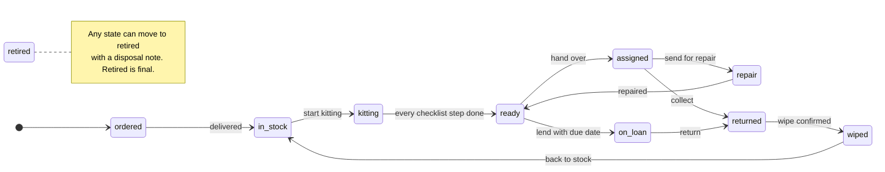

#### 2. Kitting

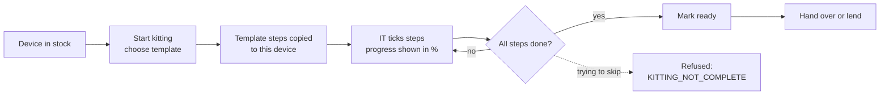

Templates exist for Windows (Autopilot / Intune), iPhone and iPad, Android, and shared-device
re-kit. When a device is kitted again, the earlier run stays as history.

#### 3. Loans, returns, and leavers

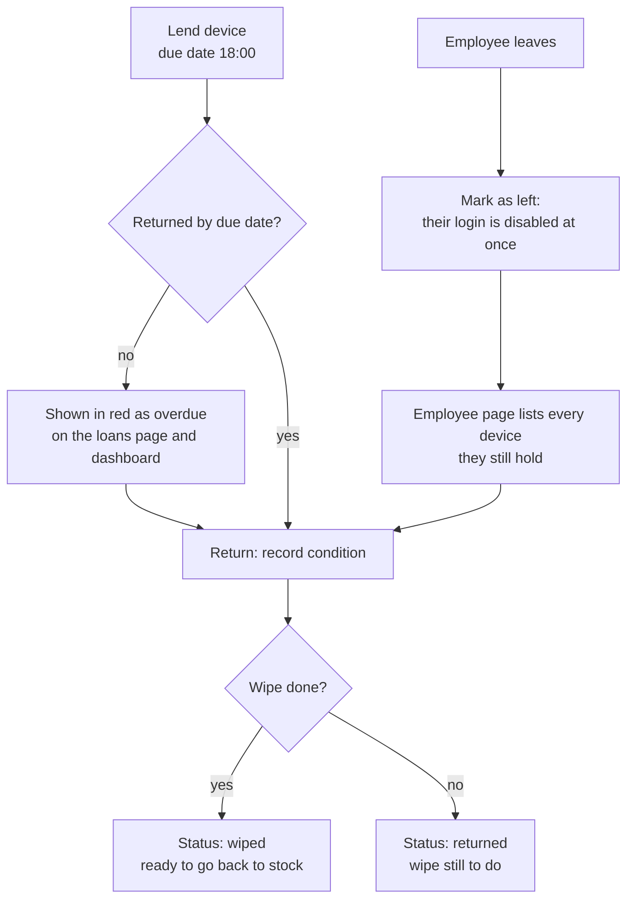

#### 4. Helpdesk and chatbot

The chatbot can search the FAQ, look up the user's own devices and tickets, and prepare a ticket.
It never creates anything by itself: the user has to confirm, within 10 minutes.

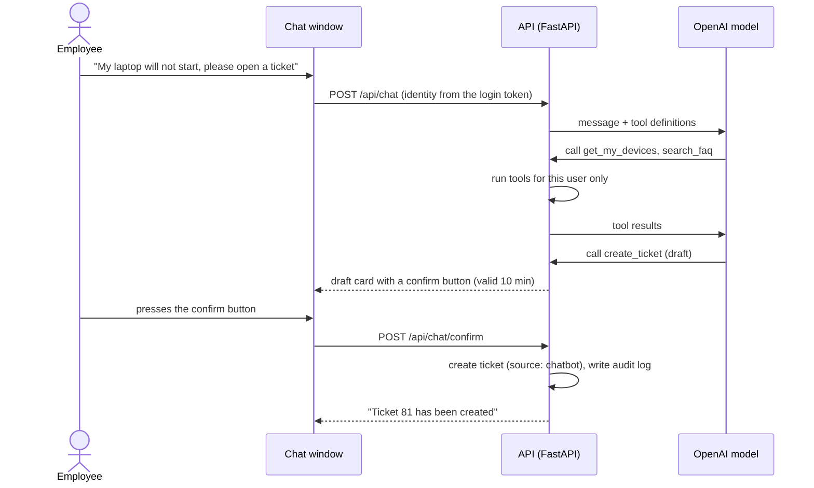

Rules behind it: the model can never pass a user id (identity always comes from the token),
history is limited to 10 messages, tool rounds to 3, and each user to 20 messages an hour.

#### 5. Ticket status

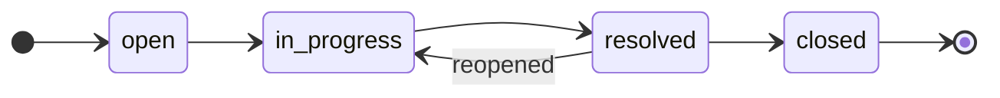

### Roles and permissions

| | super_admin | it_admin | manager | employee |
| --- | :---: | :---: | :---: | :---: |
| Devices, kitting, loans | edit | edit | read, own department | own devices |
| Employees and leaver flow | edit | edit | read, own department | |
| Tickets | all | all | own department | own tickets |
| FAQ | edit | edit | read | read |
| Dashboard | yes | yes | own department | |
| Login accounts, audit log | yes | | | |
| Chatbot | yes | yes | yes | yes |

Records outside a user's scope return **404**, not 403, so their existence is not revealed.
The role and active flag are read from the database on every request.

### Screenshots

All taken from the running application with the demo data.

| | |
| --- | --- |
|  **Device list** with filters and search |  **Device page**: only allowed status changes, kitting checklist |
|  **Kitting board** by person |  **Loans**, overdue in red |
|  **Leaver flow**: devices to collect |  **Ticket** with comments |
|  **FAQ** in the reader's language |  **English UI**, manager view |
|  **Sign-in** |  **Phone layout** (375 px) |

### Architecture and data model


- Only Caddy is reachable from the internet. It serves the frontend, adds HTTPS and security
  headers, and passes `/api` to FastAPI.
- The API and the database sit on separate Docker networks; the database network has no route out.
- Business rules live in a service layer, so the API, the chatbot tools, and CSV import all go
  through the same checks.


The ER diagram is generated from the SQLAlchemy models by
[docs/diagrams/er_diagram.py](docs/diagrams/er_diagram.py), so it always matches the real schema.

| Layer | Technology |
| --- | --- |
| Backend | Python 3.12, FastAPI, SQLAlchemy 2, Alembic, Pydantic v2 |
| Auth | JWT (PyJWT), bcrypt, slowapi rate limits |
| Database | PostgreSQL 16 |
| Frontend | HTML, CSS, JavaScript modules (no framework), Chart.js |
| Chatbot | OpenAI API with tool calling |
| Delivery | Docker Compose, Caddy, GitHub Actions |
| Cloud | AWS Lightsail, S3, IAM, Budgets, managed with Terraform |
| Testing | pytest, Ruff, pip-audit, Postman / newman, Playwright |

#### Database tables

<details>
<summary>All 13 tables and what they hold</summary>

| Table | What it holds |
| --- | --- |
| `employees` | Staff records: code, name, email, department, position, join date, status (active or left). |
| `users` | Login accounts: email, bcrypt hash, role, linked employee, language, active flag. |
| `assets` | Devices: asset tag, type, serial, maker, model, purchase and warranty dates, cost, location, status, holder. |
| `device_details` | Technical details per device: OS, CPU, memory, storage, MAC, IMEI, phone number, SIM, Autopilot, MDM, encryption, compliance. |
| `kitting_templates` | Checklist templates per device type, with steps in English and Japanese. |
| `kitting_tasks` | The checklist of one kitting run of one device: who ticked each step and when. |
| `device_loans` | Loans: device, employee, lent by, due date, return date, condition, wipe done. |
| `tickets` | Helpdesk tickets: title, description, category, priority, status, requester, assignee, device, source. |
| `ticket_comments` | Comments on tickets. |
| `faq_articles` | FAQ articles in both languages. |
| `chat_sessions` | Chatbot conversations, including a ticket draft waiting for confirmation. |
| `chat_messages` | Every user, assistant, and tool message of a conversation. |
| `audit_logs` | Who changed what and when, with details such as the old and new status (never passwords or tokens). |

</details>

### API reference

49 operations under `/api`. The interactive documentation is at `/api/docs` when the app runs in
development or demo mode. "and above" follows the order employee, manager, it_admin, super_admin.
Every error comes back as `{"detail": {"code", "message"}}`, and the screens translate it by code.

<details>
<summary>All endpoints with the role they require</summary>

**Auth and health**

| Method | Path | Role | What it does |
| --- | --- | --- | --- |
| `GET` | `/api/health` | public | Report API and database health. |
| `POST` | `/api/auth/login` | public | Exchange email and password for a 60-minute access token. |
| `GET` | `/api/auth/me` | any signed-in user | Return the logged-in user's profile. |
| `PUT` | `/api/auth/me/language` | any signed-in user | Save the user's interface language (ja or en). |
| `POST` | `/api/auth/change-password` | any signed-in user | Change the logged-in user's password after checking the current one. |

**Login accounts and audit**

| Method | Path | Role | What it does |
| --- | --- | --- | --- |
| `GET` | `/api/users` | super_admin | List login accounts. q searches the login email. |
| `POST` | `/api/users` | super_admin | Create a login, optionally linked to an employee record. |
| `PUT` | `/api/users/{user_id}` | super_admin | Change role, activate or deactivate, relink, or reset the password. |
| `GET` | `/api/audit-logs` | super_admin | Newest first. since and until are ISO 8601 times; since is inclusive, until exclusive. |

**Employees**

| Method | Path | Role | What it does |
| --- | --- | --- | --- |
| `GET` | `/api/employees` | manager and above | List employees. q searches name, employee code, and email. |
| `POST` | `/api/employees` | it_admin and above | Add an employee record. |
| `GET` | `/api/employees/{employee_id}` | manager and above | Return one employee within the caller's scope. |
| `GET` | `/api/employees/{employee_id}/devices` | manager and above | Leaver flow, step 2: every device the employee currently holds. |
| `PUT` | `/api/employees/{employee_id}` | it_admin and above | Update employee fields. Only the fields sent are changed. |
| `DELETE` | `/api/employees/{employee_id}` | it_admin and above | Leaver flow, step 1: set status to "left" and deactivate the linked login. |

**Devices**

| Method | Path | Role | What it does |
| --- | --- | --- | --- |
| `GET` | `/api/assets` | any signed-in user | List assets the caller may see. |
| `POST` | `/api/assets` | it_admin and above | Register a new device, on order or in stock. |
| `GET` | `/api/assets/export.csv` | it_admin and above | Download every asset the caller may see as CSV (UTF-8 with BOM, formula-safe). |
| `POST` | `/api/assets/import` | it_admin and above | Create assets from a CSV file. Any invalid row means nothing is saved. |
| `GET` | `/api/assets/{asset_id}` | any signed-in user | One asset with its details and allowed next statuses. |
| `PUT` | `/api/assets/{asset_id}` | it_admin and above | Edit descriptive fields. Use the status endpoint for lifecycle changes. |
| `GET` | `/api/assets/{asset_id}/details` | any signed-in user | Technical details of one asset. |
| `PUT` | `/api/assets/{asset_id}/details` | it_admin and above | Update technical details. Autopilot and Intune fields are recorded manually. |
| `POST` | `/api/assets/{asset_id}/status` | it_admin and above | Move the asset to its next lifecycle status. |
| `GET` | `/api/assets/{asset_id}/history` | manager and above | The audit timeline of one asset, oldest first. Not available to employees. |

**Kitting**

| Method | Path | Role | What it does |
| --- | --- | --- | --- |
| `GET` | `/api/kitting/templates` | it_admin and above | All kitting templates, optionally for one device type. |
| `POST` | `/api/kitting/templates` | it_admin and above | Add a kitting template with steps in English and Japanese. |
| `POST` | `/api/assets/{asset_id}/kitting/start` | it_admin and above | Move an in_stock device to kitting and create its checklist from a template. |
| `GET` | `/api/assets/{asset_id}/kitting` | manager and above | A device's kitting checklist: the latest run, or an earlier one with ?run_no=. |
| `PATCH` | `/api/kitting-tasks/{task_id}` | it_admin and above | Tick or untick one step of a device's current kitting run. |
| `GET` | `/api/kitting/board` | it_admin and above | Devices in kitting with % done, grouped by who is working on them. |

**Loans**

| Method | Path | Role | What it does |
| --- | --- | --- | --- |
| `GET` | `/api/loans` | manager and above | List loans. overdue=true keeps loans past their due date and not returned. |
| `POST` | `/api/loans` | it_admin and above | Lend a ready device to an active employee until the due date. |
| `POST` | `/api/loans/{loan_id}/return` | it_admin and above | Return a loaned device with its condition, optionally confirming a wipe. |

**Tickets**

| Method | Path | Role | What it does |
| --- | --- | --- | --- |
| `GET` | `/api/tickets` | any signed-in user | List tickets the caller may see, newest first. q searches title and description. |
| `POST` | `/api/tickets` | any signed-in user | File a new ticket. The requester comes from the caller's own employee link. |
| `GET` | `/api/tickets/assignees` | it_admin and above | Active IT staff who can be assigned a ticket, for the assignee picker. |
| `GET` | `/api/tickets/{ticket_id}` | any signed-in user | One ticket with its comments, within the caller's scope. |
| `PUT` | `/api/tickets/{ticket_id}` | any signed-in user | Change a ticket. See ticket_service.update_ticket for who may change what. |
| `POST` | `/api/tickets/{ticket_id}/comments` | any signed-in user | Comment on a ticket. Comments follow the ticket's permissions. |

**Dashboard**

| Method | Path | Role | What it does |
| --- | --- | --- | --- |
| `GET` | `/api/dashboard/summary` | manager and above | Device, kitting, loan, compliance, warranty, and ticket figures for the caller's scope. |

**FAQ**

| Method | Path | Role | What it does |
| --- | --- | --- | --- |
| `GET` | `/api/faq` | any signed-in user | Articles in one language. q searches title and body; the best matches come first. |
| `POST` | `/api/faq` | it_admin and above | Add an article. Both languages are required. |
| `GET` | `/api/faq/{article_id}` | any signed-in user | One article in the reader's language. |
| `GET` | `/api/faq/{article_id}/full` | it_admin and above | One article in both languages, for the edit form. |
| `PUT` | `/api/faq/{article_id}` | it_admin and above | Edit an article. Only the fields sent are changed. |

**Chatbot**

| Method | Path | Role | What it does |
| --- | --- | --- | --- |
| `POST` | `/api/chat` | any signed-in user | Send a message to the assistant and get its reply. |
| `POST` | `/api/chat/confirm` | any signed-in user | Create (confirm) or drop (cancel) the ticket the assistant prepared. |
| `GET` | `/api/chat/sessions/{session_id}` | any signed-in user | The user's own conversation, for reopening the chat window. |

</details>

### Quality assurance

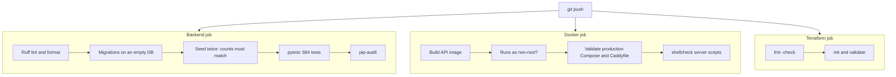

- **684 pytest tests** cover every lifecycle rule, every role and scope check, demo-mode locks,
  CSV limits, the chatbot loop with a scripted model, and FAQ search. The test suite refuses to run
  unless its database name ends in `_test`, so it can never wipe real data.
- Each business rule was also deliberately broken once to confirm that a test fails.
- **Postman collection:** 44 requests and 76 assertions, including the 403 checks for each role
  ([docs/postman/](docs/postman/)).
- **Browser checks:** every screen opened as each of the 4 roles, in both languages, at desktop and
  phone width (192 page visits), with no script errors and no missing translations.
- **Live check:** the chatbot was tested by hand against the real OpenAI API, from an FAQ answer
  to a ticket drafted, confirmed, and created.

### Security

- Passwords hashed with bcrypt, 8 to 72 bytes, never truncated. Login limited to 5 tries a minute
  per IP, the chatbot to 20 messages an hour per user.
- The JWT holds only the user id; a deactivated user is locked out on their next request.
- Every protected endpoint checks the role, and data scoping is done in the SQL query.
- Errors always use one format, `{"detail": {"code", "message"}}`, with no stack traces.
- CORS allows one origin. Pages use a Content Security Policy without `unsafe-inline`, and all
  data is written with `textContent`.
- In production only ports 80 and 443 are open; SSH is open to one IP address.
- Secrets live in `.env` on the server and never in Git. The backup access key is created outside
  Terraform so it never lands in the state file, and the backup user cannot delete backups.
- The chatbot log records only the error type and OpenAI's error code, never message text.

### Getting started

You need Docker Desktop and Python 3 (only to serve the frontend files).

```bash
git clone https://github.com/amishanita/bilingual-itsm-device-management-system.git itsm-platform
cd itsm-platform
cp .env.example .env
```

Edit `.env`: set `POSTGRES_PASSWORD` (the same value inside `DATABASE_URL` and
`TEST_DATABASE_URL`), a random `JWT_SECRET` (`python3 -c "import secrets; print(secrets.token_urlsafe(64))"`),
and a `DEMO_PASSWORD` of at least 8 characters. Then:

```bash
docker compose up -d --build
docker compose exec api alembic upgrade head
docker compose exec api python -m app.seed
python3 -m http.server 8080 -d frontend
```

Open http://localhost:8080 and sign in with one of the demo logins and your `DEMO_PASSWORD`:

| Login | Role |
| --- | --- |
| `admin@demo` | super_admin |
| `it@demo` | it_admin |
| `manager@demo` | manager |
| `employee@demo` | employee |

API documentation: http://localhost:8000/api/docs

**Chatbot (optional):** set `OPENAI_API_KEY` and a model with tool calling in `OPENAI_MODEL`. Newer
OpenAI models also need `OPENAI_REASONING_EFFORT=none`. Then run `docker compose up -d api`.

**Tests:**

```bash
cd backend
python3.12 -m venv .venv && source .venv/bin/activate
pip install -r requirements-dev.txt
export DATABASE_URL=postgresql+psycopg://itsm:<password>@localhost:5432/itsm
export TEST_DATABASE_URL=postgresql+psycopg://itsm:<password>@localhost:5432/itsm_test
pytest -q
```

### Configuration

All settings come from `.env` (copy `.env.example`). `.env` is never committed.

| Setting | Purpose |
| --- | --- |
| `APP_ENV` | `development`, `demo`, or `production`. Demo mode locks the demo logins; production refuses demo data and hides the API docs. |
| `POSTGRES_DB`, `POSTGRES_USER`, `POSTGRES_PASSWORD` | Database name and credentials. |
| `DB_HOST_PORT` | Local port for PostgreSQL (default 5432). |
| `DATABASE_URL`, `TEST_DATABASE_URL` | Connection strings. The test database name must end in `_test`. |
| `FRONTEND_ORIGIN` | The only origin allowed to call the API from a browser. |
| `FORWARDED_ALLOW_IPS` | Proxies trusted for the client IP (Caddy only, in production). |
| `JWT_SECRET` | Token signing key, at least 32 characters. The example value is refused. |
| `DEMO_PASSWORD` | Password for the four demo logins. The example value is refused. |
| `OPENAI_API_KEY`, `OPENAI_MODEL` | Chatbot. Leave either empty to switch the chatbot off. |
| `OPENAI_TIMEOUT_SECONDS`, `OPENAI_REASONING_EFFORT` | Chatbot timeout; set the effort to `none` for newer models. |
| `SITE_DOMAIN`, `ACME_EMAIL` | Server only: public domain for HTTPS and the contact for certificate notices. |
| `BACKUP_S3_BUCKET`, `BACKUP_S3_PREFIX` | Server only: where nightly backups go. |

### Demo data

`python -m app.seed` loads a complete, realistic data set. Running it again gives the same result.

| Data | Amount |
| --- | --- |
| Logins | 4, one per role |
| Employees | 30 in 5 departments, Japanese names |
| Devices | 60: 25 laptops, 20 smartphones, 10 tablets, 5 monitors, spread across every status |
| Kitting | 4 templates, 4 devices being kitted |
| Loans | 8: 4 open (3 overdue) and 4 returned |
| Tickets | 80 across every category, priority, and status, with IT replies |
| FAQ | 20 articles in both languages |

The seed refuses to run when `APP_ENV=production`. In demo mode the server resets the data every
night at 03:30.

### Deployment to AWS

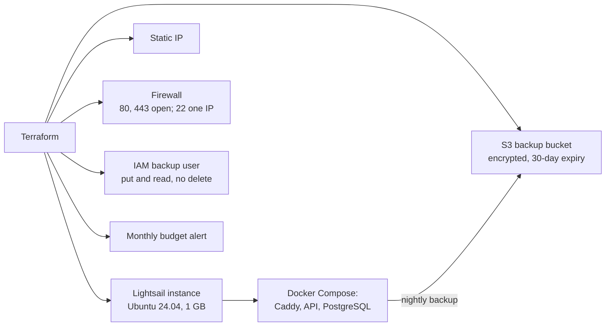

| Step | How |
| --- | --- |
| 1. Create the AWS resources | `terraform init`, `plan`, `apply` in `infra/terraform/` (14 resources) |
| 2. Prepare the server | Done on first boot: time zone, swap, security updates, Docker, AWS CLI |
| 3. Start the application | `git clone`, fill `.env`, `docker compose -f docker-compose.prod.yml up -d --build` |
| 4. Database | `alembic upgrade head`, then the seed for demo mode |
| 5. Schedule jobs | `crontab scripts/crontab.example`: backup 03:00, reset 03:30, restore test Sunday 05:00 |

Expected cost: about USD 7 a month for the Lightsail plan, plus a few cents for S3. Check current
AWS prices before applying. The full steps, in Japanese, are in [構築手順書](docs/構築手順書.md);
the Terraform details are in [infra/terraform/README.md](infra/terraform/README.md).

### Project structure

```text
itsm-platform/
├── backend/
│   ├── app/
│   │   ├── core/          settings, database, security, errors, rate limits
│   │   ├── models/        SQLAlchemy models (13 tables)
│   │   ├── schemas/       Pydantic request and response models
│   │   ├── routers/       API endpoints
│   │   ├── services/      business rules, chatbot, CSV, FAQ search
│   │   ├── seed.py        demo data
│   │   └── main.py
│   ├── alembic/           database migrations
│   ├── tests/             pytest (684 tests)
│   └── Dockerfile
├── frontend/
│   ├── *.html             12 screens
│   ├── js/                ES modules (pages, API client, i18n, chat window)
│   ├── css/
│   └── i18n/              en.json and ja.json (476 keys each)
├── infra/terraform/       AWS: Lightsail, S3, IAM, Budgets
├── scripts/               backup, restore check, nightly reset, cron
├── docs/                  diagrams, screenshots, Postman, Japanese runbooks
├── docker-compose.yml     local development
├── docker-compose.prod.yml production: Caddy, API, PostgreSQL
├── Caddyfile              HTTPS and security headers
└── .github/workflows/ci.yml
```

### Operations documents

Written in business Japanese for the team that operates the system.

| Document | Contents |
| --- | --- |
| [構築手順書](docs/構築手順書.md) | Building the server from scratch: Terraform, Docker, HTTPS, cron, first backup |
| [運用手順書](docs/運用手順書.md) | Daily checks, backup, restore, restart, adding users, updates |
| [障害対応手順書](docs/障害対応手順書.md) | Site down, disk full, certificate errors, chatbot not answering |
| [infra/terraform/README.md](infra/terraform/README.md) | AWS resources, cost, and post-deployment checks (English) |

### Scope and limitations

- Autopilot and Intune fields are typed in by hand; there is no Microsoft Graph connection yet.
- "Wipe confirmed" records that an operator wiped the device. The app does not erase anything.
- Names, ticket text, serial numbers, and notes are not translated; only the interface is.
- CSV import and export, password change, and the audit log are available in the API but have no
  screen yet.
- The production server runs in demo mode: the demo data resets every night, and there is no
  command yet to create the first admin for a real production setup.
- The chatbot is switched off on the public demo to keep the running cost at zero.

### Roadmap

1. Read device compliance from Intune through Microsoft Graph instead of typing it in.
2. Sign-in with Microsoft Entra ID, with the token in an HttpOnly cookie.
3. Screens for CSV import, password change, and the audit log.
4. Email reminders for overdue loans and warranties ending soon.
5. Playwright browser checks in CI, and uptime monitoring with alerts.
6. A command to create the first admin, so the system can run outside demo mode.

### Author

**Tamang Amish** | IT helpdesk, Japan | [GitHub](https://github.com/amishanita)

[Back to top / ページの先頭へ](#bilingual-itsm-device-management-system)

---

## 日本語

### 目次

1. [開発の背景](#開発の背景)
2. [活用したスキル](#活用したスキル)
3. [画面ごとの機能](#画面ごとの機能)
4. [業務の流れ](#業務の流れ)
5. [ロールと権限](#ロールと権限)
6. [画面](#画面)
7. [システム構成とデータモデル](#システム構成とデータモデル)
8. [API一覧](#api一覧)
9. [品質とテスト](#品質とテスト)
10. [セキュリティ](#セキュリティ)
11. [ローカルでの起動](#ローカルでの起動)
12. [設定項目](#設定項目)
13. [デモデータ](#デモデータ)
14. [AWSへのデプロイ](#awsへのデプロイ)
15. [フォルダ構成](#フォルダ構成)
16. [運用ドキュメント](#運用ドキュメント)
17. [対象範囲と制約](#対象範囲と制約)
18. [今後の改善予定](#今後の改善予定)

### 開発の背景

本プロジェクトは、日本でITヘルプデスクとして担当している日々の業務をもとに開発しました。主な業務は、
Windows AutopilotとMicrosoft Intuneを使ったPC・スマートフォンのキッティング、資産台帳の管理、予備端末の
貸出と返却期限を過ぎた端末の回収、そして繰り返し寄せられる問い合わせへの対応です。多くの職場では、
これらの情報がExcel、MDMの管理画面、問い合わせツール、担当者個人の知識に分散し、次第に整合性が
取れなくなります。

本システムは、端末に関わる業務を一元化し、通常は手作業で守っている手順をシステムで担保することを
目的としています。キッティングごとのチェックリスト、データ消去を省略できないライフサイクル、退職者が
保有する端末をすべて把握できる退職処理、そして「誰が・いつ・何を変更したか」を残す監査ログが中心です。

**デモ：** 現在は未公開です。Terraformのコードと構築手順書は完成しており、サーバーの稼働と動作確認が
完了した時点でURLを掲載します。

### 活用したスキル

| 分野 | 実装内容 | 参照先 |
| --- | --- | --- |
| **ITヘルプデスク** | ステータス・優先度・担当者・コメントを管理する問い合わせ対応フロー。実際のヘルプデスクでよくある質問をもとにした日英20件のFAQ。OpenAI API（ツール呼び出し）を使い、FAQを検索して、利用者の確認後に問い合わせを登録するAIアシスタント。 | [問い合わせ](docs/screenshots/09-ticket.png)、[FAQ](docs/screenshots/10-faq.png)、`backend/app/services/chatbot.py` |
| **IT資産管理** | ルールで制御された端末ライフサイクル、端末種別ごとのキッティングチェックリスト（Autopilot / Intune、iPhone、Android、共用端末の再キッティング）、返却期限付きの貸出、退職時の端末回収、保証終了の通知、CSVでの取り込み・出力、すべての変更履歴。 | [端末詳細](docs/screenshots/04-device-kitting.png)、[貸出管理](docs/screenshots/06-loans.png)、[退職処理](docs/screenshots/07-employee-leaver.png) |
| **社内SE・開発** | FastAPIとサービス層によるREST API、PostgreSQLとAlembicによるマイグレーション、ロールに応じたアクセス制御とSQLでの参照範囲の制御、フレームワークを使わない日英切り替え対応のフロントエンド。 | `backend/app/`、`frontend/` |
| **インフラ** | 開発・本番のDocker Compose、CaddyによるHTTPSの自動化、TerraformによるAWS構築（Lightsail、S3、IAM、予算アラート）、毎晩の暗号化バックアップと毎週のリストア確認。 | `docker-compose.prod.yml`、`infra/terraform/`、`scripts/` |
| **セキュリティ** | bcrypt、有効期限の短いJWT、回数制限、厳格なContent Security Policy、最小権限のIAM、秘密情報をGitとTerraformのstateに残さない設計。 | [セキュリティ](#セキュリティ) |
| **品質保証・運用** | 684件の自動テスト、ロール別の権限確認を含むPostmanコレクション、全画面のブラウザ確認、push時のCI、日本語の構築・運用・障害対応手順書。 | [品質とテスト](#品質とテスト)、[docs/](docs/) |

### 画面ごとの機能

| 画面 | 主な利用者 | 内容 |
| --- | --- | --- |
| **サインイン** | 全員 | メールアドレスとパスワード、パスワードの表示切り替え、Caps Lockの警告、言語切り替え。 |
| **ダッシュボード** | マネージャー以上 | 稼働中の端末、キッティング中、返却期限超過の貸出、非準拠の端末、未解決の問い合わせの件数。種別ごとの端末数とカテゴリ別の未解決問い合わせのグラフ。60日以内に保証が終了する端末。 |
| **端末一覧** | 全員（一般社員は自分の端末のみ） | 種別・ステータス・OS・コンプライアンス・貸出期限での絞り込み、資産番号・シリアル番号・IMEI・電話番号・社員名での検索、端末の登録。 |
| **端末詳細** | 全員（参照範囲内） | 全項目と技術情報、次に実行できるステータス変更だけのボタン、進捗バー付きのキッティングチェックリスト、貸出履歴、関連する問い合わせ、変更履歴。 |
| **キッティング** | IT担当 | キッティング中の端末を担当者別・進捗率付きで表示。 |
| **貸出管理** | IT担当、マネージャー | 貸出中・期限超過・返却済み・すべての切り替え、期限超過は赤で表示、返却期限付きの貸出フォーム、状態とデータ消去を記録する返却フォーム。 |
| **社員一覧** | IT担当、マネージャー | 一覧と検索、社員の登録。 |
| **社員詳細** | IT担当、マネージャー | 社員情報と編集、退職済みにする操作、保有している全端末とそれぞれの返却手段、その社員の問い合わせ。 |
| **問い合わせ一覧** | 全員（参照範囲内） | ステータス・優先度・カテゴリでの絞り込み、検索、問い合わせの登録。 |
| **問い合わせ詳細** | 全員（参照範囲内） | ステータス、優先度、担当者、コメント、関連端末。 |
| **FAQ** | 全員 | 利用者の言語でカテゴリ別に表示し、検索も可能。IT担当は日英を並べて編集。 |
| **ユーザー管理** | システム管理者 | ログインの作成、ロール変更、有効・無効、社員との紐付け、パスワードの再設定。 |
| **チャット画面** | 全員（全画面に表示） | FAQをもとに回答し、問い合わせの下書きを作成して確認後に登録するヘルプデスク用チャットボット。 |

**FAQ 20件**（日英）：パスワードのリセット、アカウントロック、多要素認証の設定、VPNに接続できない、
Outlookが同期しない、Teamsの音声、プリンターが見つからない、Wi-Fi、新しいPCの初回サインイン
（Autopilot）、Intuneのコンプライアンスエラー、iPhoneの設定、Androidの仕事用プロファイル、端末の紛失・盗難、
画面の破損、ソフトウェアのインストール依頼、共用端末の貸出、端末の返却、PCが遅い、OneDriveの同期、
ディスクの容量不足。

### 業務の流れ

#### 1. 端末のライフサイクル

端末は決められた状態の間だけを移動します。図にない変更はAPIが `INVALID_STATUS_CHANGE` として
拒否し、すべての変更は監査ログに記録されます。

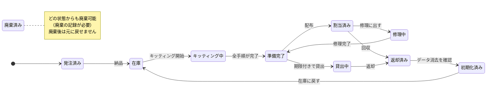

#### 2. キッティング

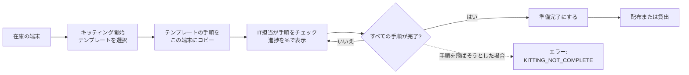

テンプレートは、Windows（Autopilot / Intune）、iPhone・iPad、Android、共用端末の再キッティングの
4種類です。同じ端末を再キッティングしても、前回の記録は履歴として残ります。

#### 3. 貸出・返却・退職処理

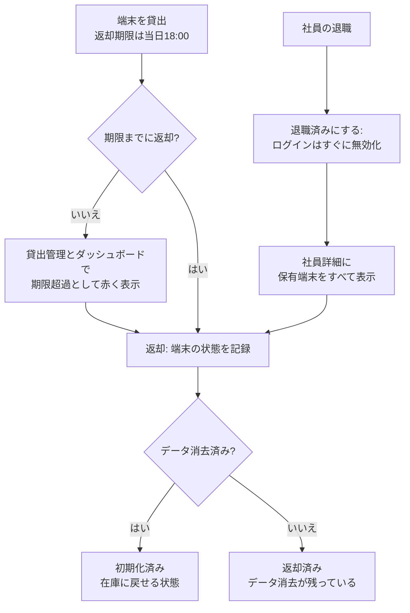

#### 4. ヘルプデスクとチャットボット

チャットボットは、FAQの検索、本人の端末と問い合わせの確認、問い合わせの下書きができます。
自分で勝手に登録することはなく、利用者が10分以内に確定ボタンを押した場合だけ登録されます。

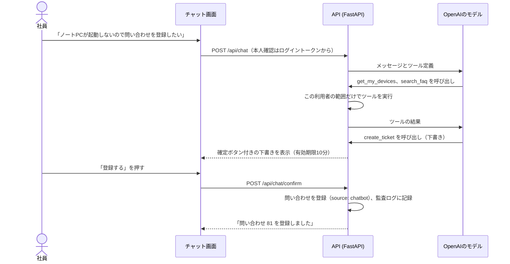

仕組み上のルール：モデルが利用者IDを指定することはできず（本人はトークンで判定）、会話履歴は
直近10件、ツールの呼び出しは1回の質問につき3回まで、利用は1人あたり1時間20回までです。

#### 5. 問い合わせのステータス

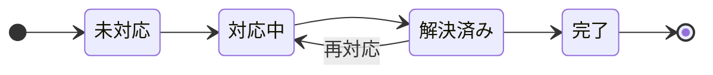

### ロールと権限

| | システム管理者 | IT管理者 | マネージャー | 一般社員 |
| --- | :---: | :---: | :---: | :---: |
| 端末・キッティング・貸出 | 編集 | 編集 | 自部署を参照 | 自分の端末 |
| 社員・退職処理 | 編集 | 編集 | 自部署を参照 | |
| 問い合わせ | すべて | すべて | 自部署 | 自分の問い合わせ |
| FAQ | 編集 | 編集 | 参照 | 参照 |
| ダッシュボード | ○ | ○ | 自部署 | |
| ログインアカウント・監査ログ | ○ | | | |
| チャットボット | ○ | ○ | ○ | ○ |

参照範囲外のデータには403ではなく **404** を返し、存在自体を知られないようにしています。
ロールと有効・無効は、リクエストのたびにデータベースから読み直します。

### 画面

すべて、デモデータを入れた実際の画面です。

| | |
| --- | --- |
|  **端末一覧**（絞り込み・検索） |  **端末詳細**：実行できるステータス変更だけを表示、キッティングチェックリスト |
|  **キッティング状況**（担当者別） |  **貸出管理**（期限超過は赤） |
|  **退職処理**：回収する端末の一覧 |  **問い合わせ詳細**とコメント |
|  **FAQ**（利用者の言語で表示） |  **英語表示**（マネージャー） |
|  **サインイン** |  **スマートフォン表示**（375px） |

### システム構成とデータモデル


- インターネットから接続できるのはCaddyだけです。画面の配信、HTTPS化、セキュリティヘッダーの付与を
  行い、`/api` へのリクエストをFastAPIに渡します。
- APIとデータベースは別々のDockerネットワークに置き、データベース側は外部に出られない設定です。
- 業務ルールはサービス層にまとめているため、API・チャットボット・CSV取り込みのどこから操作しても
  同じチェックが働きます。


ER図はSQLAlchemyのモデル定義から [docs/diagrams/er_diagram.py](docs/diagrams/er_diagram.py) で
生成しているため、実際のテーブル構成と常に一致します。

| 分野 | 技術 |
| --- | --- |
| バックエンド | Python 3.12、FastAPI、SQLAlchemy 2、Alembic、Pydantic v2 |
| 認証 | JWT（PyJWT）、bcrypt、slowapiによる回数制限 |
| データベース | PostgreSQL 16 |
| フロントエンド | HTML、CSS、JavaScript（フレームワークなし）、Chart.js |
| チャットボット | OpenAI API（ツール呼び出し） |
| 配布・運用 | Docker Compose、Caddy、GitHub Actions |
| クラウド | AWS Lightsail、S3、IAM、Budgets（Terraformで管理） |
| テスト | pytest、Ruff、pip-audit、Postman / newman、Playwright |

#### テーブル一覧

<details>
<summary>13テーブルの内容</summary>

| テーブル | 内容 |
| --- | --- |
| `employees` | 社員：社員番号、氏名、メールアドレス、部署、役職、入社日、ステータス（在籍・退職） |
| `users` | ログインアカウント：メールアドレス、bcryptのハッシュ、ロール、紐付く社員、表示言語、有効・無効 |
| `assets` | 端末：資産番号、種別、シリアル番号、メーカー、機種、購入日、保証終了日、購入金額、保管場所、ステータス、利用者 |
| `device_details` | 端末の技術情報：OS、CPU、メモリ、ストレージ、MACアドレス、IMEI、電話番号、SIM、Autopilot、MDM、暗号化、コンプライアンス |
| `kitting_templates` | 端末種別ごとのチェックリストのテンプレート（手順は日英） |
| `kitting_tasks` | 1台の端末の1回分のキッティングチェックリスト（誰がいつ完了したか） |
| `device_loans` | 貸出：端末、社員、貸出担当、返却期限、返却日時、状態、データ消去の有無 |
| `tickets` | 問い合わせ：件名、内容、カテゴリ、優先度、ステータス、依頼者、担当者、関連端末、登録元 |
| `ticket_comments` | 問い合わせへのコメント |
| `faq_articles` | FAQ記事（日英） |
| `chat_sessions` | チャットボットの会話と、確定待ちの問い合わせ案 |
| `chat_messages` | 会話内の利用者・アシスタント・ツールのすべてのメッセージ |
| `audit_logs` | 誰がいつ何を変更したか（変更前後のステータスなど。パスワードやトークンは記録しない） |

</details>

### API一覧

`/api` 配下に49個のエンドポイントがあります。開発モードとデモモードでは `/api/docs` で対話的な
ドキュメントを確認できます。「以上」は 一般社員 → マネージャー → IT管理者 → システム管理者 の順です。
エラーは常に `{"detail": {"code", "message"}}` の形式で返し、画面側でコードから日英の文言に変換します。

<details>
<summary>全エンドポイントと必要なロール</summary>

**認証・ヘルスチェック**

| メソッド | パス | 必要なロール | 内容 |
| --- | --- | --- | --- |
| `GET` | `/api/health` | 不要（公開） | APIとデータベースの稼働確認 |
| `POST` | `/api/auth/login` | 不要（公開） | メールアドレスとパスワードで60分有効のトークンを発行 |
| `GET` | `/api/auth/me` | ログイン済み | ログイン中のユーザー情報 |
| `PUT` | `/api/auth/me/language` | ログイン済み | 表示言語（ja / en）を保存 |
| `POST` | `/api/auth/change-password` | ログイン済み | 現在のパスワードを確認してから変更 |

**ログインアカウント・監査ログ**

| メソッド | パス | 必要なロール | 内容 |
| --- | --- | --- | --- |
| `GET` | `/api/users` | システム管理者 | ログインアカウントの一覧（メールアドレスで検索） |
| `POST` | `/api/users` | システム管理者 | ログインアカウントを作成（社員と紐付け可能） |
| `PUT` | `/api/users/{user_id}` | システム管理者 | ロール変更、有効・無効、紐付け変更、パスワードの再設定 |
| `GET` | `/api/audit-logs` | システム管理者 | 監査ログ（新しい順、対象・操作・ユーザー・期間で絞り込み） |

**社員**

| メソッド | パス | 必要なロール | 内容 |
| --- | --- | --- | --- |
| `GET` | `/api/employees` | マネージャー以上 | 社員の一覧（氏名・社員番号・メールアドレスで検索） |
| `POST` | `/api/employees` | IT管理者以上 | 社員を登録 |
| `GET` | `/api/employees/{employee_id}` | マネージャー以上 | 社員の詳細（参照範囲内のみ） |
| `GET` | `/api/employees/{employee_id}/devices` | マネージャー以上 | 退職処理：その社員が保有している端末の一覧 |
| `PUT` | `/api/employees/{employee_id}` | IT管理者以上 | 社員情報を更新（送信した項目のみ） |
| `DELETE` | `/api/employees/{employee_id}` | IT管理者以上 | 退職処理：退職済みにして、紐付いたログインを無効化 |

**端末**

| メソッド | パス | 必要なロール | 内容 |
| --- | --- | --- | --- |
| `GET` | `/api/assets` | ログイン済み | 参照できる端末の一覧（種別・状態・OS・コンプライアンス・期限超過・キーワード） |
| `POST` | `/api/assets` | IT管理者以上 | 端末を登録（発注済みまたは在庫） |
| `GET` | `/api/assets/export.csv` | IT管理者以上 | 端末一覧をCSVで出力（BOM付きUTF-8、数式の埋め込み対策済み） |
| `POST` | `/api/assets/import` | IT管理者以上 | CSVから端末を一括登録（1行でもエラーがあれば何も登録しない） |
| `GET` | `/api/assets/{asset_id}` | ログイン済み | 端末の詳細と、次に変更できるステータス |
| `PUT` | `/api/assets/{asset_id}` | IT管理者以上 | 端末の基本情報を編集（ステータスは専用APIで変更） |
| `GET` | `/api/assets/{asset_id}/details` | ログイン済み | 端末の技術情報 |
| `PUT` | `/api/assets/{asset_id}/details` | IT管理者以上 | 技術情報を更新（AutopilotとIntuneの項目は手入力） |
| `POST` | `/api/assets/{asset_id}/status` | IT管理者以上 | ライフサイクルの次のステータスへ変更 |
| `GET` | `/api/assets/{asset_id}/history` | マネージャー以上 | 端末の変更履歴（一般社員は参照不可） |

**キッティング**

| メソッド | パス | 必要なロール | 内容 |
| --- | --- | --- | --- |
| `GET` | `/api/kitting/templates` | IT管理者以上 | キッティングテンプレートの一覧 |
| `POST` | `/api/kitting/templates` | IT管理者以上 | テンプレートを追加（手順は日英両方） |
| `POST` | `/api/assets/{asset_id}/kitting/start` | IT管理者以上 | 在庫の端末をキッティング中にし、テンプレートからチェックリストを作成 |
| `GET` | `/api/assets/{asset_id}/kitting` | マネージャー以上 | 端末のキッティングチェックリスト（過去の実施分も参照可能） |
| `PATCH` | `/api/kitting-tasks/{task_id}` | IT管理者以上 | チェックリストの手順を完了・未完了にする |
| `GET` | `/api/kitting/board` | IT管理者以上 | キッティング中の端末を担当者別・進捗率付きで表示 |

**貸出**

| メソッド | パス | 必要なロール | 内容 |
| --- | --- | --- | --- |
| `GET` | `/api/loans` | マネージャー以上 | 貸出の一覧（期限超過のみの絞り込み可能） |
| `POST` | `/api/loans` | IT管理者以上 | 準備完了の端末を在籍中の社員に期限付きで貸出 |
| `POST` | `/api/loans/{loan_id}/return` | IT管理者以上 | 返却処理（端末の状態、データ消去の確認） |

**問い合わせ**

| メソッド | パス | 必要なロール | 内容 |
| --- | --- | --- | --- |
| `GET` | `/api/tickets` | ログイン済み | 参照できる問い合わせの一覧（新しい順、キーワード検索） |
| `POST` | `/api/tickets` | ログイン済み | 問い合わせを登録（依頼者は本人の社員情報から設定） |
| `GET` | `/api/tickets/assignees` | IT管理者以上 | 担当者として選べるIT担当の一覧 |
| `GET` | `/api/tickets/{ticket_id}` | ログイン済み | 問い合わせの詳細とコメント（参照範囲内のみ） |
| `PUT` | `/api/tickets/{ticket_id}` | ログイン済み | 問い合わせを更新（ロールにより変更できる項目が異なる） |
| `POST` | `/api/tickets/{ticket_id}/comments` | ログイン済み | 問い合わせにコメントを追加 |

**ダッシュボード**

| メソッド | パス | 必要なロール | 内容 |
| --- | --- | --- | --- |
| `GET` | `/api/dashboard/summary` | マネージャー以上 | 端末・キッティング・貸出・コンプライアンス・保証・問い合わせの集計 |

**FAQ**

| メソッド | パス | 必要なロール | 内容 |
| --- | --- | --- | --- |
| `GET` | `/api/faq` | ログイン済み | 利用者の言語でFAQを一覧・検索（関連度の高い順） |
| `POST` | `/api/faq` | IT管理者以上 | FAQを追加（日英両方が必須） |
| `GET` | `/api/faq/{article_id}` | ログイン済み | FAQ記事を利用者の言語で表示 |
| `GET` | `/api/faq/{article_id}/full` | IT管理者以上 | FAQ記事を日英両方で取得（編集画面用） |
| `PUT` | `/api/faq/{article_id}` | IT管理者以上 | FAQ記事を編集（送信した項目のみ） |

**チャットボット**

| メソッド | パス | 必要なロール | 内容 |
| --- | --- | --- | --- |
| `POST` | `/api/chat` | ログイン済み | チャットボットにメッセージを送信し、回答を受け取る |
| `POST` | `/api/chat/confirm` | ログイン済み | チャットボットが作成した問い合わせ案を確定または取り消し |
| `GET` | `/api/chat/sessions/{session_id}` | ログイン済み | 本人の会話履歴（チャット画面を再度開いたとき用） |

</details>

### 品質とテスト

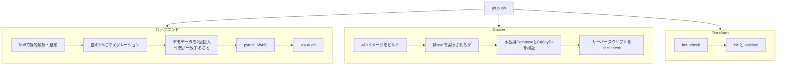

- **pytest 684件**で、ライフサイクルの全ルール、ロールと参照範囲、デモモードの制限、CSVの上限、
  擬似モデルを使ったチャットボットの流れ、FAQ検索を確認しています。テスト用データベース名の
  末尾が `_test` でなければテスト自体が起動しないため、本番データを消すことはありません。
- 各業務ルールについて、意図的にルールを壊し、テストが失敗することも確認しています。
- **Postmanコレクション：** 44リクエスト、ロールごとの403確認を含む76項目
  （[docs/postman/](docs/postman/)）。
- **ブラウザでの確認：** 4つのロール × 2言語 × PCとスマートフォンの幅で全画面を開き（計192画面）、
  スクリプトエラーと翻訳漏れがないことを確認しました。
- **実環境での確認：** チャットボットは実際のOpenAI APIで、FAQを使った回答から問い合わせの下書き・
  確定・登録までを手動で確認しました。

### セキュリティ

- パスワードはbcryptで保存し、8～72バイト、切り詰めは行いません。ログインはIPごとに1分5回、
  チャットボットは1人あたり1時間20回までです。
- JWTにはユーザーIDだけを含めます。無効にしたユーザーは次のリクエストから利用できなくなります。
- 保護されたすべてのエンドポイントでロールを確認し、参照範囲はSQLの条件で制御します。
- エラーは常に `{"detail": {"code", "message"}}` の形式で返し、スタックトレースは出しません。
- CORSは1つのオリジンだけを許可します。画面は `unsafe-inline` を使わないContent Security Policyで
  配信し、データは `textContent` で表示します。
- 本番で開いているポートは80と443だけで、SSHは特定の1つのIPアドレスからのみ接続できます。
- 秘密情報はサーバーの `.env` に置き、Gitには含めません。バックアップ用のアクセスキーはTerraformの外で
  発行してstateに残さず、バックアップ用ユーザーにはバックアップの削除権限を与えていません。
- チャットボットのログには、エラーの種類とOpenAIのエラーコードだけを記録し、メッセージ本文は残しません。

### ローカルでの起動

Docker Desktopと、画面のファイルを配信するためのPython 3が必要です。

```bash
git clone https://github.com/amishanita/bilingual-itsm-device-management-system.git itsm-platform
cd itsm-platform
cp .env.example .env
```

`.env` を編集し、`POSTGRES_PASSWORD`（`DATABASE_URL` と `TEST_DATABASE_URL` の中も同じ値）、ランダムな
`JWT_SECRET`（`python3 -c "import secrets; print(secrets.token_urlsafe(64))"`）、8文字以上の
`DEMO_PASSWORD` を設定してから、次を実行します。

```bash
docker compose up -d --build
docker compose exec api alembic upgrade head
docker compose exec api python -m app.seed
python3 -m http.server 8080 -d frontend
```

http://localhost:8080 を開き、デモ用アカウントと設定した `DEMO_PASSWORD` でサインインします。

| ログインID | ロール |
| --- | --- |
| `admin@demo` | システム管理者 |
| `it@demo` | IT管理者 |
| `manager@demo` | マネージャー |
| `employee@demo` | 一般社員 |

APIドキュメント：http://localhost:8000/api/docs

**チャットボット（任意）：** `OPENAI_API_KEY` と、ツール呼び出しに対応したモデル名を `OPENAI_MODEL` に
設定します。新しいOpenAIモデルでは `OPENAI_REASONING_EFFORT=none` も必要です。設定後に
`docker compose up -d api` を実行してください。

**テスト：**

```bash
cd backend
python3.12 -m venv .venv && source .venv/bin/activate
pip install -r requirements-dev.txt
export DATABASE_URL=postgresql+psycopg://itsm:<password>@localhost:5432/itsm
export TEST_DATABASE_URL=postgresql+psycopg://itsm:<password>@localhost:5432/itsm_test
pytest -q
```

### 設定項目

設定はすべて `.env`（`.env.example` をコピー）から読み込みます。`.env` はGitに含めません。

| 項目 | 用途 |
| --- | --- |
| `APP_ENV` | `development`、`demo`、`production`。デモモードではデモアカウントを変更不可にし、本番モードではデモデータの投入を拒否してAPIドキュメントを非公開にします。 |
| `POSTGRES_DB`、`POSTGRES_USER`、`POSTGRES_PASSWORD` | データベース名と接続情報 |
| `DB_HOST_PORT` | ローカルのPostgreSQLのポート（初期値5432） |
| `DATABASE_URL`、`TEST_DATABASE_URL` | 接続文字列。テスト用データベース名は末尾が `_test` である必要があります。 |
| `FRONTEND_ORIGIN` | ブラウザからAPIを呼び出せる唯一のオリジン |
| `FORWARDED_ALLOW_IPS` | クライアントIPを信頼するプロキシ（本番ではCaddyのみ） |
| `JWT_SECRET` | トークンの署名鍵（32文字以上、例の値のままだと起動しません） |
| `DEMO_PASSWORD` | 4つのデモアカウントのパスワード（例の値のままだと投入を拒否します） |
| `OPENAI_API_KEY`、`OPENAI_MODEL` | チャットボット。どちらかが空欄ならチャットボットは停止します。 |
| `OPENAI_TIMEOUT_SECONDS`、`OPENAI_REASONING_EFFORT` | タイムアウト秒数と推論設定（新しいモデルでは `none`） |
| `SITE_DOMAIN`、`ACME_EMAIL` | サーバーのみ：HTTPSの対象ドメインと証明書の通知先 |
| `BACKUP_S3_BUCKET`、`BACKUP_S3_PREFIX` | サーバーのみ：毎晩のバックアップの保存先 |

### デモデータ

`python -m app.seed` で、実際の業務に近いデータ一式を投入します。何度実行しても同じ結果になります。

| データ | 件数 |
| --- | --- |
| ログイン | 4件（ロールごとに1件） |
| 社員 | 30名（5部署、日本人の氏名） |
| 端末 | 60台：ノートPC 25台、スマートフォン 20台、タブレット 10台、モニター 5台（全ステータスに分散） |
| キッティング | テンプレート4種類、キッティング中の端末4台 |
| 貸出 | 8件：貸出中4件（うち期限超過3件）、返却済み4件 |
| 問い合わせ | 80件（全カテゴリ・優先度・ステータス、IT担当の返信付き） |
| FAQ | 20件（日英） |

`APP_ENV=production` ではデータ投入を拒否します。デモモードのサーバーでは、毎晩3時30分にデータを初期状態に戻します。

### AWSへのデプロイ

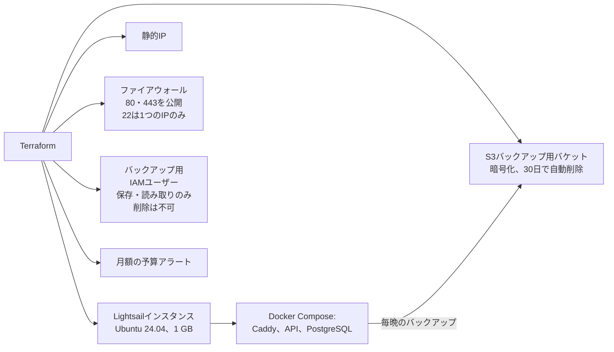

| 手順 | 方法 |
| --- | --- |
| 1. AWSリソースの作成 | `infra/terraform/` で `terraform init`、`plan`、`apply`（14リソース） |
| 2. サーバーの準備 | 初回起動時に自動実行：タイムゾーン、スワップ、セキュリティ更新、Docker、AWS CLI |
| 3. アプリケーションの起動 | `git clone`、`.env` の設定、`docker compose -f docker-compose.prod.yml up -d --build` |
| 4. データベース | `alembic upgrade head`、デモモードではデモデータを投入 |
| 5. 定期実行の登録 | `crontab scripts/crontab.example`：3時バックアップ、3時30分データ初期化、日曜5時リストア確認 |

想定費用はLightsailのプランで月額約7米ドルと、S3の数セントです。作成前に最新のAWS料金を確認してください。
詳しい手順は [構築手順書](docs/構築手順書.md)、Terraformの詳細は [infra/terraform/README.md](infra/terraform/README.md) にあります。

### フォルダ構成

```text
itsm-platform/
├── backend/
│   ├── app/
│   │   ├── core/          設定、DB接続、セキュリティ、エラー、回数制限
│   │   ├── models/        SQLAlchemyのモデル（13テーブル）
│   │   ├── schemas/       Pydanticの入出力定義
│   │   ├── routers/       APIエンドポイント
│   │   ├── services/      業務ルール、チャットボット、CSV、FAQ検索
│   │   ├── seed.py        デモデータ
│   │   └── main.py
│   ├── alembic/           マイグレーション
│   ├── tests/             pytest（684件）
│   └── Dockerfile
├── frontend/
│   ├── *.html             12画面
│   ├── js/                ESモジュール（各画面、APIクライアント、多言語、チャット画面）
│   ├── css/
│   └── i18n/              en.json と ja.json（各476キー）
├── infra/terraform/       AWS：Lightsail、S3、IAM、Budgets
├── scripts/               バックアップ、リストア確認、毎晩の初期化、cron
├── docs/                  図、画面キャプチャ、Postman、日本語の手順書
├── docker-compose.yml     ローカル開発用
├── docker-compose.prod.yml 本番用：Caddy、API、PostgreSQL
├── Caddyfile              HTTPSとセキュリティヘッダー
└── .github/workflows/ci.yml
```

### 運用ドキュメント

本システムを運用する担当者向けに、ビジネス日本語で作成しています。

| ドキュメント | 内容 |
| --- | --- |
| [構築手順書](docs/構築手順書.md) | サーバーの新規構築：Terraform、Docker、HTTPS、cron、初回バックアップ |
| [運用手順書](docs/運用手順書.md) | 定期確認、バックアップ、リストア、再起動、ユーザー追加、アップデート |
| [障害対応手順書](docs/障害対応手順書.md) | サイトに接続できない、ディスク不足、証明書エラー、チャットボットが応答しない |
| [infra/terraform/README.md](infra/terraform/README.md) | AWSリソース、費用、構築後の確認（英語） |

### 対象範囲と制約

- AutopilotとIntuneの項目は手入力です。Microsoft Graphとの連携はまだありません。
- 「データ消去済み」は担当者が消去したことの記録で、アプリが端末を消去するわけではありません。
- 氏名、問い合わせ本文、シリアル番号、備考は翻訳しません。翻訳するのは画面の表示だけです。
- CSVの取り込み・出力、パスワード変更、監査ログはAPIで利用できますが、画面はまだありません。
- 本番サーバーはデモモードで運用します。デモデータは毎晩初期状態に戻り、本格的な本番運用向けに
  最初の管理者を作成するコマンドはまだありません。
- 公開デモでは運用費をかけないため、チャットボットを停止しています。

### 今後の改善予定

1. Microsoft Graph経由でIntuneからコンプライアンス状態を取得し、手入力をなくす。
2. Microsoft Entra IDでのサインインに対応し、トークンをHttpOnly Cookieで扱う。
3. CSV取り込み、パスワード変更、監査ログの画面を作る。
4. 返却期限超過と保証終了が近い端末をメールで通知する。
5. PlaywrightのブラウザテストをCIに組み込み、死活監視とアラートを追加する。
6. 最初の管理者を作成するコマンドを追加し、デモモード以外でも運用できるようにする。

### 作成者

**Tamang Amish**　ITヘルプデスク（日本）　[GitHub](https://github.com/amishanita)

[ページの先頭へ / Back to top](#bilingual-itsm-device-management-system)
